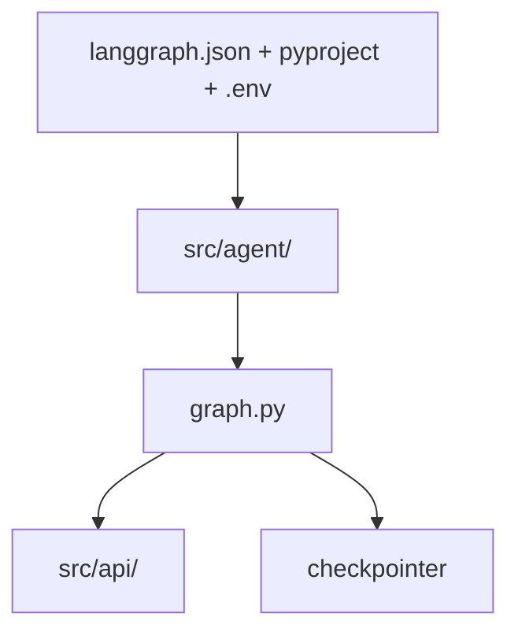

# langgraph-base

This project is an effort to create a minimal, production-minded LangGraph starter.
It consolidates the official deploy contract with proven community scale patterns.
It is uv-only, no pip, and deploys with LangGraph CLI and LangSmith.
Start with `src/agent/`, grow into `src/agents/` and `src/api/` only when needed.



## What is inside

- [`STRUCTURE.md`](STRUCTURE.md) holds the full layout spec, file roles, and workflow patterns.
- [`EXAMPLES.md`](EXAMPLES.md) specs the example agents to build.
- Deploy, packaging, and env config follow the official application structure.
- All tooling is uv-only, see Quickstart below.

## Example agents

- ReAct tool agent answers "book me tomorrow 10am" by looping chat, ToolNode, chat.
- RAG assistant answers "what is your refund policy" via retrieve then generate with citations.
- Router triage sends refund questions to RAG, date requests to booking, rest to chat.
- Parallel workers fan out with `Send` to sentiment, urgency, and category, then aggregate.
- Evaluator-optimizer grades drafts with structured output and loops back, capped below 3 iterations.

## Quickstart

```bash
cp .env.example .env
uv sync
uv run langgraph dev
uv run pytest
```

## References

- Application structure - Docs by LangChain - https://docs.langchain.com/oss/python/langgraph/application-structure
- langchain-ai/new-langgraph-project - https://github.com/langchain-ai/new-langgraph-project
- langchain-ai/langgraph-example-pyproject - https://github.com/langchain-ai/langgraph-example-pyproject
- martinpercu/Langchain-Langgraph_Agents-Structure - https://github.com/martinpercu/Langchain-Langgraph_Agents-Structure
- wassim249/fastapi-langgraph-agent-production-ready-template - https://github.com/wassim249/fastapi-langgraph-agent-production-ready-template
- RealPython LangGraph Tutorial - https://realpython.com/langgraph-python/
- Workflows and agents patterns - https://docs.langchain.com/oss/python/langgraph/workflows-agents
