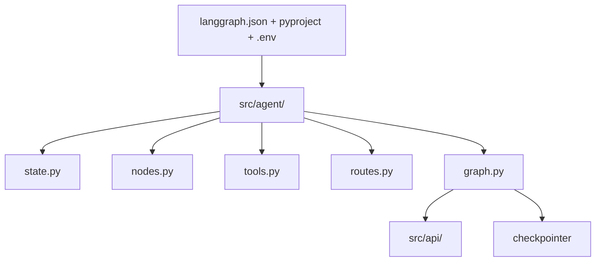

# STRUCTURE

This file is the source of truth for the LangGraph project layout.
It extends the official deploy contract with a scalable per-agent split.
Start with `src/agent/` flat files.
Split into `src/agents/<name>/` only when node count grows.



## Complete structure

```text
langgraph-base/
├── src/
│   ├── agent/
│   │   ├── __init__.py
│   │   ├── state.py         # TypedDict state schema, single source of truth
│   │   ├── nodes.py         # node functions, pure state in and state out
│   │   ├── tools.py         # @tool definitions bound with bind_tools
│   │   ├── routes.py        # conditional edge functions, no LLM side effects
│   │   ├── prompts.py       # system prompts and Jinja2 templates
│   │   ├── graph.py         # StateGraph wiring and compile
│   │   └── configuration.py # Context schema for runtime config
│   ├── agents/
│   │   └── support_agent/
│   │       ├── __init__.py
│   │       ├── state.py
│   │       ├── nodes/
│   │       │   ├── __init__.py
│   │       │   ├── extractor.py
│   │       │   └── conversation.py
│   │       ├── routes/
│   │       │   ├── __init__.py
│   │       │   └── intention.py
│   │       ├── tools/
│   │       │   ├── __init__.py
│   │       │   └── booking.py
│   │       └── support_agent.py # make_the_agent factory with checkpointer injection
│   └── api/
│       ├── __init__.py
│       ├── main.py          # FastAPI app, thin adapter over graph.invoke
│       └── db.py            # checkpointer lifespan and dependency
├── tests/
│   ├── __init__.py
│   ├── test_graph.py
│   └── test_routes.py
├── evals/
│   └── eval_runner.py       # LangSmith datasets and grading, optional
├── notebooks/
│   └── 01-graph-intro.ipynb # experiments only, never imported by src
├── static/
│   └── studio_ui.png        # LangGraph Studio asset, optional
├── docker-compose.yml       # postgres for langgraph-checkpoint-postgres, optional
├── langgraph.json           # graphs, dependencies, env pointer
├── pyproject.toml           # deps and src layout, use uv
├── uv.lock
├── .env.example
├── .env
├── Makefile                 # uv shortcuts for install, dev, test
├── STRUCTURE.md             # this file, full layout spec
└── README.md                # quickstart only, links here
```

`uv.lock` is generated by `uv sync`.
Do not commit `.env`.
Use `.env.example` as the template.

## uv commands

Run `uv sync` to install dependencies.
Run `uv run langgraph dev` to start the local server.
Run `uv run pytest` to run tests.

## Why this layout

`langgraph.json` is the deploy contract.
`src/agent/` holds one deployable graph.
`src/agents/<name>/` replaces `src/agent/` flat files when node count grows.
`src/api/` stays thin and never contains graph logic.
`checkpointer` is injected by factory, never hardcoded in graph module.

## File roles

### `langgraph.json`

This file maps graph name to module variable for CLI and Cloud.
It points `env` to `./.env` for local dev.
Production sets env vars in the deployment environment instead.
Example:

```json
{
  "dependencies": ["."],
  "graphs": {
    "agent": "./src/agent/graph.py:graph"
  },
  "env": "./.env"
}
```

For multi-agent, add one entry per factory:

```json
{
  "dependencies": ["."],
  "graphs": {
    "support_agent": "./src/agents/support_agent/support_agent.py:make_the_agent"
  },
  "env": "./.env"
}
```

### `src/agent/state.py`

This file defines `TypedDict` state.
Keep state minimal and typed.
Use `MessagesState` as base when the graph is conversational.
Add one field per cross-node concern only.

### `src/agent/nodes.py`

Each function takes state and returns a partial state update.
Keep LLM calls and tool calls here.
Keep routing decisions out of nodes.
Split into `nodes/*.py` when one file exceeds one workflow.

### `src/agent/tools.py`

This file defines LangChain `@tool` functions.
Keep tools side effect free or idempotent where possible.
Export a `tools` list for `llm.bind_tools(tools)`.
Add `ToolNode` only when you need parallel execution and error handling.

### `src/agent/routes.py`

Each function takes state and returns the next node name.
Keep routing pure and deterministic.
Use `with_structured_output` router model when LLM decides the route.
Wire with `add_conditional_edges`.

### `src/agent/graph.py`

This file builds `StateGraph`, adds nodes and edges, then compiles.
Export a `graph` variable for `langgraph.json`.
Use a `make_the_agent(checkpointer)` factory when FastAPI needs postgres persistence.
Do not import FastAPI or DB code here.

### `src/api/`

This layer translates HTTP to `graph.invoke` or `graph.stream`.
It owns auth, rate limit, logging, and request schemas.
It provides the checkpointer via lifespan dependency.
It never defines nodes, edges, or prompts.

### `tests/` and `evals/`

Unit test routes and reducers with fixed state.
Integration test `graph.invoke` with recorded LLM fixtures.
Put LLM-as-judge grading in `evals/`, not in `tests/`.
Run evals on demand, not on every commit.

## Workflow patterns supported

This structure supports prompt chaining, parallelization, routing, orchestrator-worker with `Send`, evaluator-optimizer loop, and ReAct agent with tools.
Add one route function per pattern.
Add one worker node per `Send` target.
Cap evaluator loops with a max iteration guard.

## References

1. Application structure - Docs by LangChain - https://docs.langchain.com/oss/python/langgraph/application-structure
2. langchain-ai/new-langgraph-project - https://github.com/langchain-ai/new-langgraph-project
3. langchain-ai/langgraph-example-pyproject - https://github.com/langchain-ai/langgraph-example-pyproject
4. martinpercu/Langchain-Langgraph_Agents-Structure - https://github.com/martinpercu/Langchain-Langgraph_Agents-Structure
5. wassim249/fastapi-langgraph-agent-production-ready-template - https://github.com/wassim249/fastapi-langgraph-agent-production-ready-template
6. RealPython LangGraph Tutorial - https://realpython.com/langgraph-python/
7. Workflows and agents patterns - https://docs.langchain.com/oss/python/langgraph/workflows-agents
