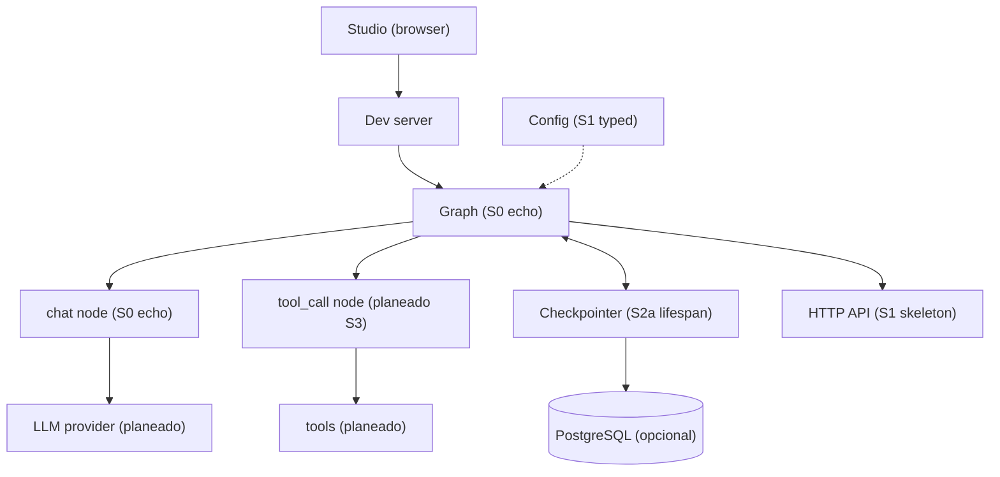
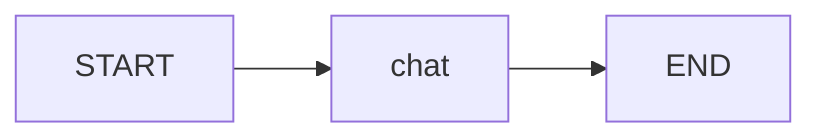
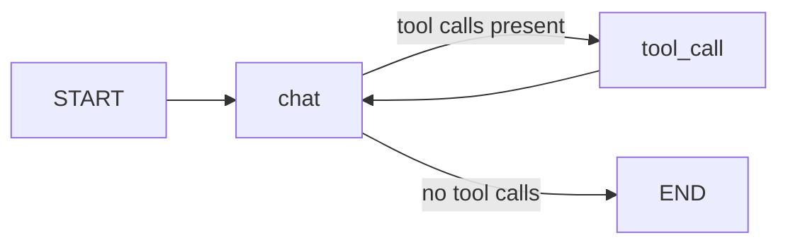

# Architecture

This doc shows how the starter fits together today and where it grows next.
S0 ships the echo graph in `src/agent/graph.py:1` with state and a pure chat node.
S1 adds the HTTP skeleton in `src/api/app.py:1` with typed settings.
S2a adds persisted threads with a lifespan checkpointer plus app migrations.
LLM fallback, memory, auth, and observability are still marked as planned.
The layout follows the spec in `docs/structure.md:1`.

## System overview

Studio is the local client until the HTTP API exists.
The dev server loads the `agent` graph declared in `langgraph.json:1`.
Postgres is optional and persists checkpoints once the lifespan checkpointer connects.

## Component responsibilities

| Component | Path | Status | Responsibility |
| --- | --- | --- | --- |
| Deploy contract | `langgraph.json:1` | Existe | Maps the `agent` name to the graph variable and points env to `.env` |
| Package state | `src/agent/state.py:1` | Existe | Defines `GraphState` with `messages` only |
| Graph wiring | `src/agent/graph.py:1` | Existe | Builds single-node START to chat to END and exports `graph` |
| Nodes | `src/agent/nodes.py:1` | Existe | Echoes the last human message with no LLM or I/O |
| Tools | `src/agent/tools/:1` | Planeado | Holds one capability module per file behind a shared list |
| Routes | `src/agent/routes.py:1` | Planeado | Keeps pure routing from state to the next node name |
| Prompts | `src/agent/prompts/:1` | Planeado | Stores system templates loaded once at startup |
| Context schema | `src/agent/configuration.py:1` | Planeado | Declares model name, limits, and store name |
| HTTP API | `src/api/v1/:1` | Existe | Skeleton translates HTTP into graph invoke or stream calls |
| Settings | `src/core/config.py:1` | Existe | Loads typed settings from env vars |
| Services | `src/services/:1` | Existe | Owns database access with lifespan checkpointer; LLM fallback and memory stay planned |
| Checkpointer | AsyncPostgresSaver | Existe | Persists full state per thread for resume and multi-turn memory |
| Storage | `docker-compose.yml:2` | Existe | Runs optional local Postgres on port 5432 |
| Tests | `tests/unit_tests/:1` | Existe | Covers the echo node and graph without model calls |

## Request lifecycle

The S0 lifecycle runs today with the echo graph in `src/agent/graph.py:1`.
Each step below runs in order for one user message.

1. Studio sends a user message to the dev server.
2. The dev server loads the `agent` graph from `langgraph.json:1`.
3. The `chat` node echoes the last human message with no LLM call.
4. The single-node chain returns directly with no `tool_call` routing yet.
5. The lifespan checkpointer persists state per `thread_id` when Postgres is reachable, else the invoke stays stateless.
6. The final message returns to Studio.

The S1 HTTP lifecycle runs through `src/api/app.py:1`.

1. Client posts to `/api/v1/chat` or `/api/v1/chat/stream`.
2. `RequestContextMiddleware` assigns or reuses `X-Request-ID` and binds `thread_id` into the JSON access log to stdout.
3. The route invokes the echo graph with `graph.invoke` or `graph.stream`.
4. The reply returns with `thread_id` pass-through plus `X-Request-ID`; stream SSE data events carry `thread_id` and end with `[DONE]`.
5. `GET /health` returns status ok plus dependencies (`loop: ok`, `store: ready` or `not_configured` or `unavailable`, `cache: not_configured`). `GET /metrics` returns the stub.

Auth, rate limits, and background memory writes are planned with `src/services/`.

## Agent graph

S0 runs a single-node chain.

The two-node loop below is planned for S3.

The S0 `chat` node echoes the last human message.
The planned `tool_call` node will run tools concurrently and feed results back to `chat`.
The planned loop ends when the reply carries no tool calls.

## Growth path

Start with flat files in `src/agent/` per `docs/structure.md:5`.
Add `src/api/` only when shipping HTTP to users.
Add `src/core/` and `src/services/` only for shared concerns like config or memory.
Keep the checkpointer injected by factory and never hardcode it in the graph module.
Build the five agent specs in `docs/examples.md:1` in order and router last.
