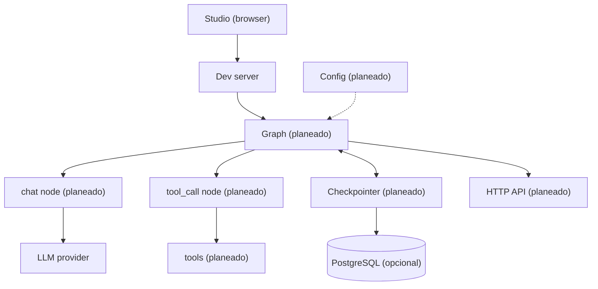
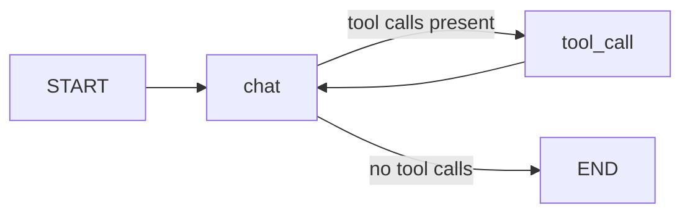

# Architecture

This doc shows how the starter fits together today and where it grows next.
Only `src/agent/__init__.py:1` exists and every other block below is marked as planned.
The layout follows the spec in `docs/structure.md:1`.

## System overview

Studio is the local client until the HTTP API exists.
The dev server loads the `agent` graph declared in `langgraph.json:1`.
Postgres is optional and only stores checkpoints once the checkpointer lands.

## Component responsibilities

| Component | Path | Status | Responsibility |
| --- | --- | --- | --- |
| Deploy contract | `langgraph.json:1` | Existe | Maps the `agent` name to the graph variable and points env to `.env` |
| Package state | `src/agent/state.py:1` | Planeado | Defines `GraphState` as the single source of truth |
| Graph wiring | `src/agent/graph.py:1` | Planeado | Builds the `chat` to `tool_call` loop and exports `graph` |
| Nodes | `src/agent/nodes.py:1` | Planeado | Runs LLM and tool calls and returns partial state updates |
| Tools | `src/agent/tools/:1` | Planeado | Holds one capability module per file behind a shared list |
| Routes | `src/agent/routes.py:1` | Planeado | Keeps pure routing from state to the next node name |
| Prompts | `src/agent/prompts/:1` | Planeado | Stores system templates loaded once at startup |
| Context schema | `src/agent/configuration.py:1` | Planeado | Declares model name, limits, and store name |
| HTTP API | `src/api/v1/:1` | Planeado | Translates HTTP into graph invoke or stream calls |
| Settings | `src/core/config.py:1` | Planeado | Loads typed settings from env vars |
| Services | `src/services/:1` | Planeado | Owns LLM fallback, memory, and database access |
| Checkpointer | AsyncPostgresSaver | Planeado | Persists full state per thread for resume and multi-turn memory |
| Storage | `docker-compose.yml:2` | Existe | Runs optional local Postgres on port 5432 |
| Tests | `tests/unit_tests/:1` | Existe | Covers nodes, routes, and tools without model calls |

## Request lifecycle

The full lifecycle is planned until `src/agent/graph.py:1` exists.
Each step below runs in order for one user message.

1. Studio sends a user message to the dev server.
2. The dev server loads the `agent` graph from `langgraph.json:1`.
3. The `chat` node calls the LLM with the current state.
4. The graph routes to `tool_call` when the reply contains tool calls.
5. The checkpointer persists state per thread in Postgres.
6. The final message returns to Studio.

Auth, rate limits, and background memory writes are planned with `src/api/` and `src/services/`.

## Agent graph

The planned agent is a two-node loop.

The `chat` node answers or requests tool calls.
The `tool_call` node runs tools concurrently and feeds results back to `chat`.
The loop ends when the reply carries no tool calls.

## Growth path

Start with flat files in `src/agent/` per `docs/structure.md:5`.
Add `src/api/` only when shipping HTTP to users.
Add `src/core/` and `src/services/` only for shared concerns like config or memory.
Keep the checkpointer injected by factory and never hardcode it in the graph module.
Build the five agent specs in `docs/examples.md:1` in order and router last.
