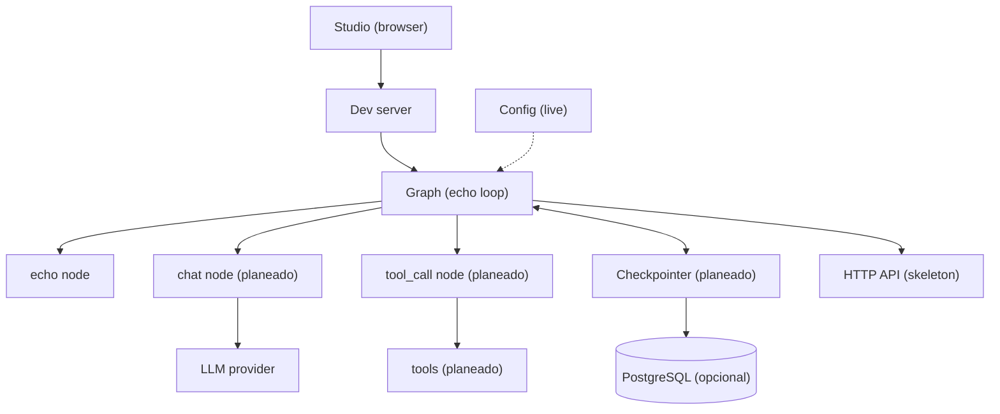
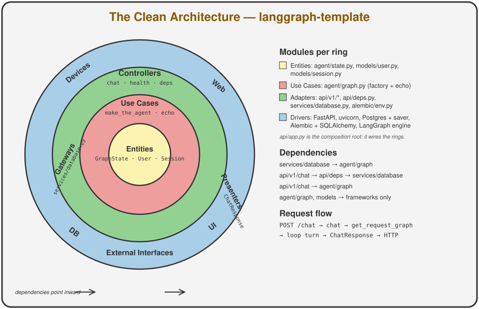
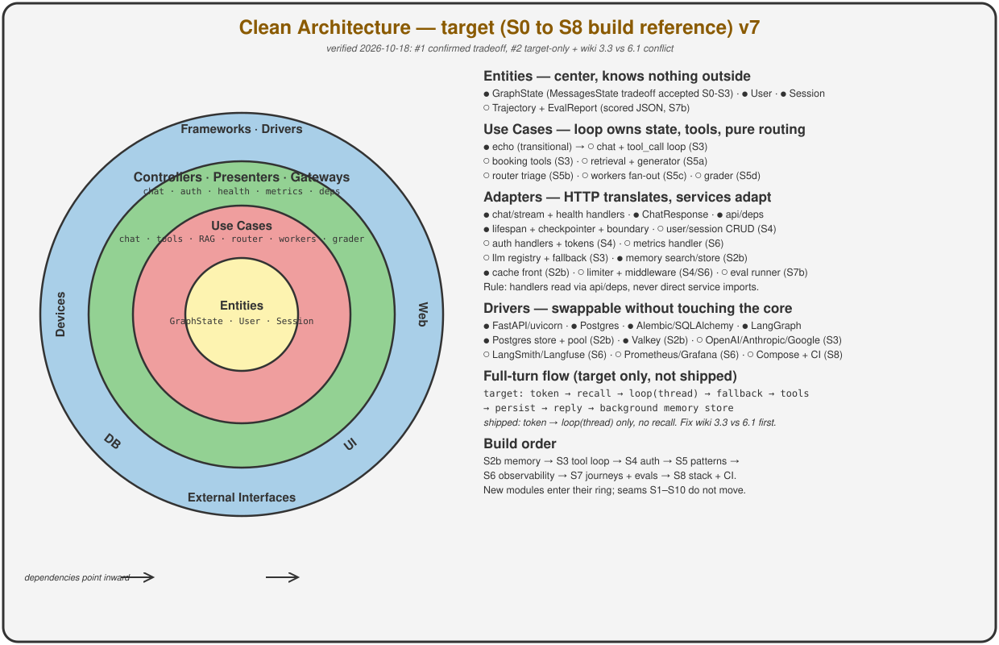
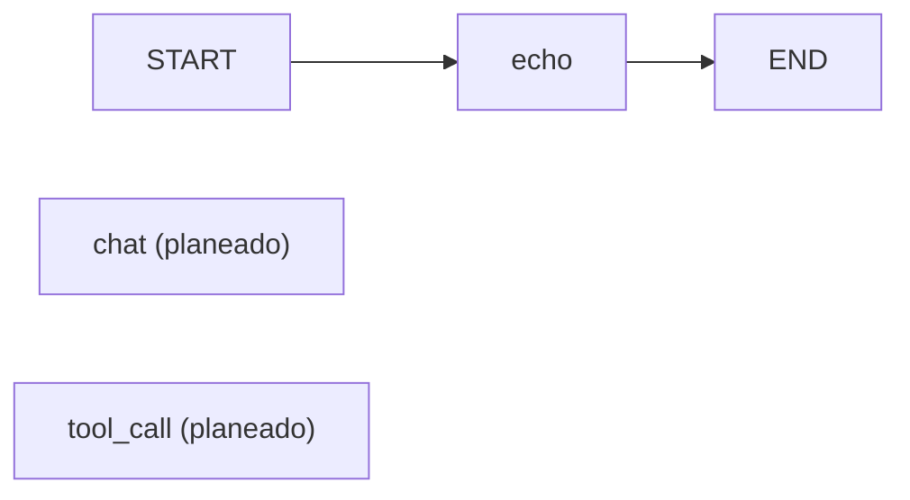

# Architecture

This doc shows how the starter fits together today and where it grows next.
An echo loop plus HTTP chat are live, the remaining blocks are marked as planned.
The layout follows the spec in `docs/structure.md:1`.

## System overview

Studio is the local client and the HTTP skeleton serves the same loop.
The dev server loads the `agent` graph declared in `langgraph.json:1`.
Postgres is optional and only stores checkpoints once the checkpointer lands.

## Component responsibilities

| Component | Path | Status | Responsibility |
| --- | --- | --- | --- |
| Deploy contract | `langgraph.json:1` | Existe | Maps the `agent` name to the graph variable and points env to `.env` |
| Package state | `src/agent/state.py:1` | Existe | Defines `GraphState` as the single source of truth |
| Graph wiring | `src/agent/graph.py:1` | Existe | Echo loop exports `graph` with recall via `get_store` plus cache, `chat` to `tool_call` arrives with the tool-calling loop |
| Nodes | `src/agent/nodes.py:1` | Planeado | Runs LLM and tool calls and returns partial state updates |
| Tools | `src/agent/tools/:1` | Planeado | Holds one capability module per file behind a shared list |
| Routes | `src/agent/routes.py:1` | Planeado | Keeps pure routing from state to the next node name |
| Prompts | `src/agent/prompts/:1` | Planeado | Stores system templates loaded once at startup |
| Context schema | `src/agent/configuration.py:1` | Planeado | Declares model name, limits, and store name |
| HTTP API | `src/api/v1/:1` | Existe | Skeleton translates HTTP into graph invoke or stream calls with transitional `X-User-ID`, auth arrives with the auth lifecycle |
| Settings | `src/core/config.py:1` | Existe | Loads typed settings from env vars with documented defaults |
| Cache | `src/core/cache.py:1` | Existe | Valkey front with in-memory TTL fallback for recall |
| Memory | `src/services/memory.py:1` | Existe | Per-user namespaces plus extract plus background writer over `BaseStore` |
| Services | `src/services/:1` | Parcial | Database access exists, LLM fallback stays planned |
| Checkpointer | AsyncPostgresSaver | Existe | Persists full state per thread for resume and multi-turn memory |
| Storage | `docker-compose.yml:2` | Existe | Runs local pgvector on port 5432 plus Valkey on port 6379 |
| Tests | `tests/unit_tests/:1` | Existe | Covers the loop plus settings plus HTTP plus memory isolation without model calls |

### Clean architecture rings

Entities (`GraphState`, `User`, `Session`) know no HTTP or Postgres.
The loop factory plus nodes are the use cases.
HTTP handlers, `api/deps`, the lifespan in `services/database`, and `alembic/env` are adapters.
Dependencies point inward; handlers resolve the loop through the `api/deps` Depends seam.

### Target rings

Target is the destination map verified 2026-10-18: `GraphState` keeps the `MessagesState` tradeoff until the tool loop replaces echo, recall runs on `invoke` plus `ainvoke` plus `astream` when the lifespan-wired graph serves the turn with transitional `X-User-ID`.

## Request lifecycle

The echo lifecycle is live and the full tool loop arrives later.
Each step below runs in order for one user message.

1. Studio sends a user message to the dev server.
2. The dev server loads the `agent` graph from `langgraph.json:1`.
3. The `echo` node loads per-user recall as `docs` when a caller id is present, with no model call.
4. The graph ends the turn with no tool calls.
5. The checkpointer persists state per thread in Postgres when the lifespan provides it; without Postgres the loop stays ephemeral with in-memory recall. Persisted graphs require the async serving path because `AsyncPostgresSaver` is async-only.
6. Memory extraction plus store runs as Starlette background tasks after the reply without slowing the chat path.
7. The final message returns to Studio.

Auth and rate limits are planned with `src/api/` and `src/services/`; recall uses transitional `X-User-ID` until session tokens land, and production ignores that header.

## Agent graph

The repo ships a one-node echo loop and the two-node loop below arrives with tool calling.

The `echo` node answers with the last human text and no model call.
The `chat` node answers or requests tool calls once the tool-calling loop exists.
The `tool_call` node runs tools concurrently and feeds results back to `chat` once it exists.
The loop ends when the reply carries no tool calls.

## Growth path

Start with flat files in `src/agent/` per `docs/structure.md:5`.
The repo includes `src/api/` with the HTTP skeleton and `src/core/` with settings plus middleware.
Add `src/services/` only for shared concerns like LLM fallback or memory.
Keep the checkpointer injected by factory and never hardcode it in the graph module.
Build the five agent specs in `docs/examples.md:1` in order and router last.
