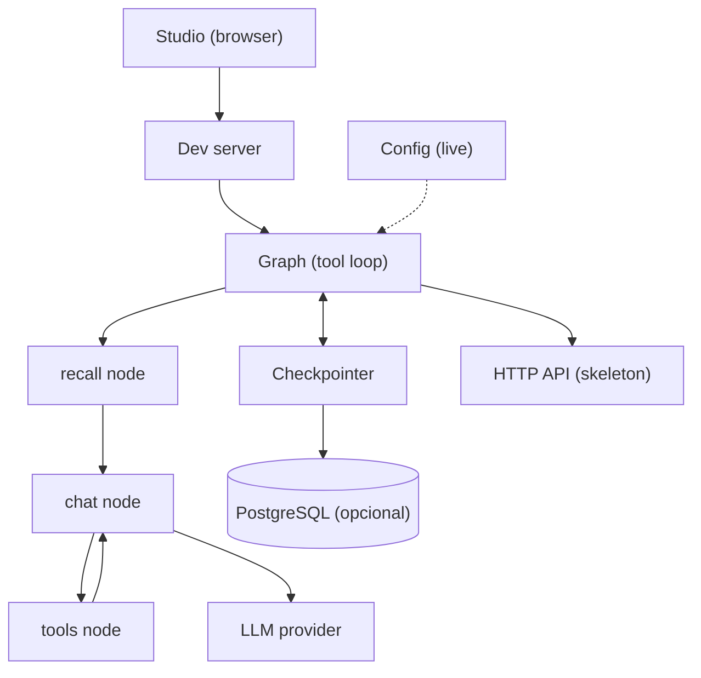
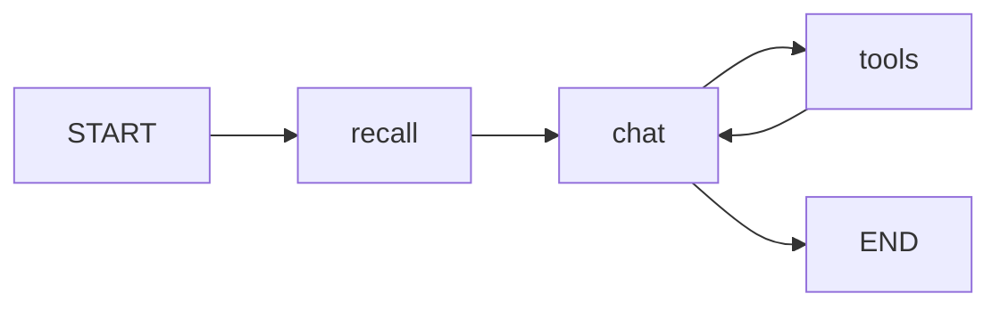

# Architecture

This doc shows how the starter fits together today and where it grows next.
A tool loop with model fallback plus HTTP chat are live, auth plus observability stay planned.
The layout follows the spec in `docs/structure.md:1`.

## System overview

Studio is the local client and the HTTP skeleton serves the same loop.
The dev server loads the `agent` graph declared in `langgraph.json:1`.
Postgres is optional; without it the loop stays ephemeral, with it threads persist per thread identifier.

## Component responsibilities

| Component | Path | Status | Responsibility |
| --- | --- | --- | --- |
| Deploy contract | `langgraph.json:1` | Existe | Maps the `agent` name to the graph variable and points env to `.env` |
| Package state | `src/agent/state.py:1` | Existe | Defines `GraphState` as the single source of truth |
| Graph wiring | `src/agent/graph.py:37` | Existe | Recall mas `chat` a `tools` con `ToolNode`, echo solo sin llm |
| Nodes | `src/agent/nodes.py:142` | Existe | Recall una vez por turno mas chat via fallback con echo sin llm |
| Tools | `src/agent/tools/:1` | Existe | Booking con `get_availability` mas `book_appointment` detras de lista compartida |
| Routes | `src/agent/routes.py:14` | Existe | `should_continue` delega en `tools_condition`, puro de `tool_calls` al siguiente nodo |
| Prompts | `src/agent/prompts/:1` | Planeado | Stores system templates loaded once at startup |
| Context schema | `src/agent/configuration.py:1` | Planeado | Declares model name, limits, and store name |
| HTTP API | `src/api/v1/:1` | Existe | Skeleton translates HTTP into graph invoke or stream calls with transitional `X-User-ID`, auth arrives with the auth lifecycle |
| Settings | `src/core/config.py:1` | Existe | Loads typed settings from env vars with documented defaults |
| Cache | `src/core/cache.py:1` | Existe | Valkey front with in-memory TTL fallback for recall |
| Memory | `src/services/memory.py:1` | Existe | Per-user namespaces plus extract plus background writer over `BaseStore` |
| Services | `src/services/:1` | Existe | Database mas memory mas LLM fallback con retries y circular |
| Checkpointer | AsyncPostgresSaver | Existe | Persists full state per thread for resume and multi-turn memory |
| Storage | `docker-compose.yml:2` | Existe | Runs local pgvector on port 5432 plus Valkey on port 6379 |
| Tests | `tests/unit_tests/:1` | Existe | Covers the loop plus fallback plus tools plus settings plus HTTP plus memory isolation without model calls |

### Clean architecture rings

Entities (`GraphState`, `User`, `Session`) know no HTTP or Postgres.
The loop factory plus nodes are the use cases.
HTTP handlers, `api/deps`, the lifespan in `services/database`, and `alembic/env` are adapters.
Dependencies point inward; handlers resolve the loop through the `api/deps` Depends seam.

### Target rings

Target is the destination map verified 2026-10-21: `GraphState` keeps the `MessagesState` tradeoff while the tool loop owns `recall` plus `chat` plus `tools`, recall runs on `invoke` plus `ainvoke` plus `astream` when the lifespan-wired graph serves the turn with transitional `X-User-ID`.

## Request lifecycle

The tool loop lifecycle is live with echo fallback when no model keys are set.
Each step below runs in order for one user message.

1. Studio sends a user message to the dev server.
2. The dev server loads the `agent` graph from `langgraph.json:1`.
3. The `recall` node loads per-user recall as `docs` once per turn when a caller id is present, with no model call.
4. The `chat` node answers through the model fallback, or echoes the last human text when no llm is wired.
5. When the reply carries `tool_calls`, the `tools` node runs them and feeds results back to `chat` until no calls remain.
6. The checkpointer persists state per thread in Postgres when the lifespan provides it; without Postgres the loop stays ephemeral with in-memory recall. Persisted graphs require the async serving path because `AsyncPostgresSaver` is async-only.
7. Memory extraction plus store runs as Starlette background tasks after the reply without slowing the chat path.
8. The final message returns to Studio.

Auth and rate limits are planned with `src/api/` and `src/services/`; recall uses transitional `X-User-ID` until session tokens land, and production ignores that header.

## Agent graph

The repo ships the tool loop below, with echo fallback when no model keys are set.

The `recall` node loads per-user recall once per turn.
The `chat` node answers through the fallback or echoes with no llm wired.
The `tools` node runs tool calls concurrently and feeds results back to `chat`.
The loop ends when the reply carries no tool calls.

## Growth path

Start with flat files in `src/agent/` per `docs/structure.md:5`.
The repo includes `src/api/` with the HTTP skeleton and `src/core/` with settings plus middleware.
Add `src/services/` only for shared concerns like LLM fallback or memory.
Keep the checkpointer injected by factory and never hardcode it in the graph module.
Build the five agent specs in `docs/examples.md:1` in order and router last.
