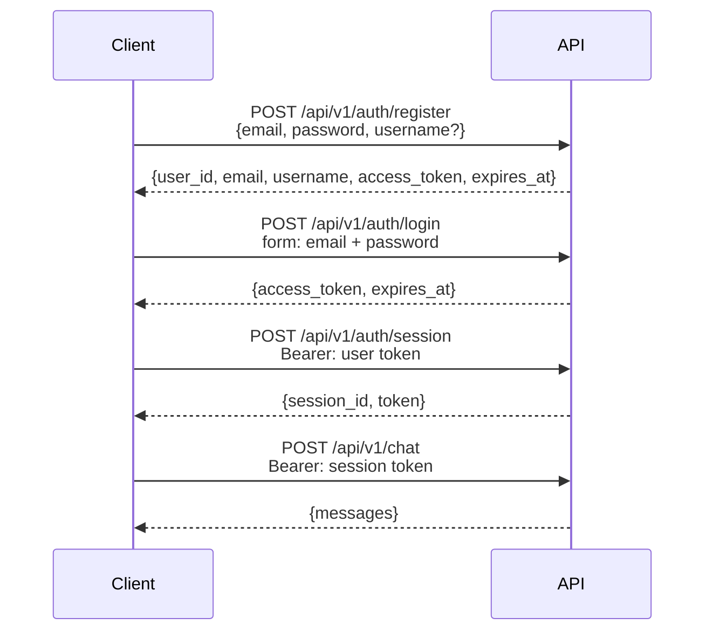

# Authentication

Estado: live.
El flujo JWT y los endpoints estan implementados con user tokens y session tokens.
Este documento describe el diseno objetivo adaptado a este starter.

## Donde vive

La capa HTTP vive en `src/api/v1/auth.py:1`.
La configuracion JWT vive en `src/core/config.py:1`.
Los modelos ORM viven en `src/models/:1`.
Los esquemas Pydantic viven en `src/schemas/:1`.
El layout completo esta en `docs/structure.md:22`.
Nunca expongas modelos ORM directo en la API.

## Flujo



La API usara dos alcances de token.
El token de usuario identifica a la persona y sirve para crear y listar sesiones.
El token de sesion identifica una conversacion y sera obligatorio en los endpoints de chat.
Ambos seran JWT firmados con HS256 y expiracion configurable.

## Endpoints planeados

### `POST /api/v1/auth/register`

Crea una cuenta nueva con email, password y username opcional.
Devuelve `user_id`, `email`, `username`, `access_token` y `expires_at` como el login.
El password requerira 8 o mas caracteres con mayuscula, minuscula, numero y simbolo.
El username se pasara al system prompt para personalizar las respuestas.

```json
{
  "email": "you@example.com",
  "password": "ChangeMe123!",
  "username": "you"
}
```

### `POST /api/v1/auth/login`

Intercambia credenciales por un token de usuario con formato OAuth2 password grant.
Devuelve `access_token` y `expires_at`.

```bash
curl -X POST /api/v1/auth/login \
  -F "username=you@example.com" \
  -F "password=ChangeMe123!" \
  -F "grant_type=password"
```

### `POST /api/v1/auth/session`

Crea una sesion de chat nueva y requiere un token de usuario valido.
Devuelve `session_id` y un token con alcance a esa sesion.

```bash
curl -X POST /api/v1/auth/session \
  -H "Authorization: Bearer <user token>"
```

### `PATCH /api/v1/auth/session/{session_id}/name`

Renombra una sesion existente.
Requiere el token de sesion correspondiente.

```bash
curl -X PATCH /api/v1/auth/session/{session_id}/name \
  -H "Authorization: Bearer <session token>" \
  -F "name=My research session"
```

### `DELETE /api/v1/auth/session/{session_id}`

Elimina una sesion y su historial de chat.
Requiere el token de sesion correspondiente.

### `GET /api/v1/auth/sessions`

Lista todas las sesiones del usuario autenticado.
Requiere un token de usuario valido.

## Configuracion

La clave de firma vive en `JWT_SECRET_KEY` dentro de `.env.example:1`.
La expiracion vive en `JWT_USER_EXPIRE_MINUTES` y `JWT_SESSION_EXPIRE_MINUTES`.
Usa un valor largo y aleatorio de al menos 32 caracteres en produccion.
Nunca publiques el contenido de `.env:1`.

## Notas de seguridad

Los passwords se guardan con hash argon2id via pwdlib y nunca en texto plano.
Cada JWT incluye un reclamo `jti` para que cada token sea unico.
Las entradas se validan con Pydantic en el borde y el username se normaliza.
El registro y el login tendran rate limits contra fuerza bruta en `src/core/limiter.py:1`.
El rate limit es planeado porque `src/core/limiter.py:1` aun no existe.
