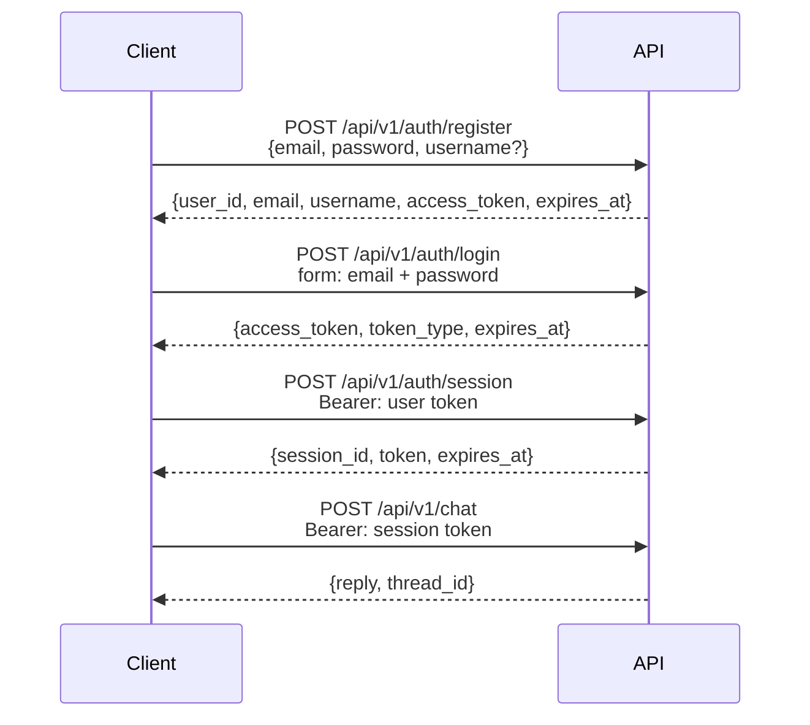

# Authentication

Estado: live.
El flujo JWT y los endpoints estan implementados en `src/api/v1/auth.py:1`.
Los guards de alcance viven en `src/api/deps.py:1`.

## Donde vive

La capa HTTP vive en `src/api/v1/auth.py:1`.
Los guards de token viven en `src/api/deps.py:1`.
La configuracion JWT vive en `src/core/config.py:1`.
El hashing y los JWT viven en `src/core/security.py:1`.
El rate limit vive en `src/core/limiter.py:1`.
Los modelos ORM viven en `src/models/:1`.
Los esquemas Pydantic viven en `src/schemas/auth.py:1`.
El layout completo esta en `docs/structure.md:39`.
Nunca expongas modelos ORM directo en la API.

## Flujo



La API usa dos alcances de token.
El token de usuario identifica a la persona y sirve para crear y listar sesiones.
El token de sesion identifica una conversacion y es obligatorio en los endpoints de chat.
Ambos son JWT firmados con HS256 y expiracion configurable.
El chat valida el token por firma y fija el thread al `sid` del token.
Sin token la respuesta es 401; con alcance equivocado es 403.

## Endpoints

### `POST /api/v1/auth/register`

Crea una cuenta nueva con email, password y username opcional.
Devuelve `200` con `user_id`, `email`, `username`, `access_token` y `expires_at`.
El password requiere 8 o mas caracteres con mayuscula, minuscula, numero y simbolo; si falla es 422.
El email se normaliza a minusculas; duplicado devuelve 409.
El username se copia a cada sesion para personalizar las respuestas.

```json
{
  "email": "you@example.com",
  "password": "ChangeMe123!",
  "username": "you"
}
```

### `POST /api/v1/auth/login`

Intercambia credenciales por un token de usuario con formato OAuth2 password grant.
Acepta `username` o `email` mas `password`; usa `grant_type=password`.
Devuelve `200` con `access_token`, `token_type` y `expires_at`.
Credenciales invalidas devuelven 401 sin revelar que campo fallo.

```bash
curl -X POST /api/v1/auth/login \
  -F "username=you@example.com" \
  -F "password=ChangeMe123!" \
  -F "grant_type=password"
```

### `POST /api/v1/auth/session`

Crea una sesion de chat nueva y requiere un token de usuario valido.
Acepta un cuerpo JSON opcional con `name`.
Devuelve `200` con `session_id`, `token` de alcance sesion y `expires_at`.
Sin token es 401; con token de sesion es 403.

```bash
curl -X POST /api/v1/auth/session \
  -H "Authorization: Bearer <user token>" \
  -H "Content-Type: application/json" \
  -d '{"name": "research"}'
```

### `PATCH /api/v1/auth/session/{session_id}/name`

Renombra una sesion existente.
Requiere el token de sesion correspondiente al `session_id` de la ruta.
Token de otra sesion devuelve 403; sesion inexistente devuelve 404.

```bash
curl -X PATCH /api/v1/auth/session/{session_id}/name \
  -H "Authorization: Bearer <session token>" \
  -H "Content-Type: application/json" \
  -d '{"name": "My research session"}'
```

### `DELETE /api/v1/auth/session/{session_id}`

Elimina una sesion y su fila de historial.
Requiere el token de sesion correspondiente; mismas reglas 403/404 que el rename.
Devuelve `200` con `session_id` y `deleted: true`.

### `GET /api/v1/auth/sessions`

Lista solo las sesiones del usuario autenticado.
Requiere un token de usuario valido; con token de sesion es 403.

## Configuracion

La clave de firma vive en `JWT_SECRET_KEY` dentro de `.env.example:10`.
La expiracion en dias vive en `JWT_ACCESS_TOKEN_EXPIRE_DAYS` dentro de `.env.example:11`.
Ambas estan tipadas en `src/core/config.py:1`.
Usa un valor largo y aleatorio de al menos 32 caracteres en produccion.
Nunca publiques el contenido de `.env:1`.

## Notas de seguridad

Los passwords se guardan con hash bcrypt y nunca en texto plano.
Cada JWT incluye un reclamo `jti` para que cada token sea unico.
El registro y el login tienen rate limits contra fuerza bruta en `src/core/limiter.py:1`.
Budgets stay in memory per IP plus route (20 attempts per 60 seconds).
Los errores usan la misma envelope `{error{code, message}, request_id}` con `X-Request-ID`.
