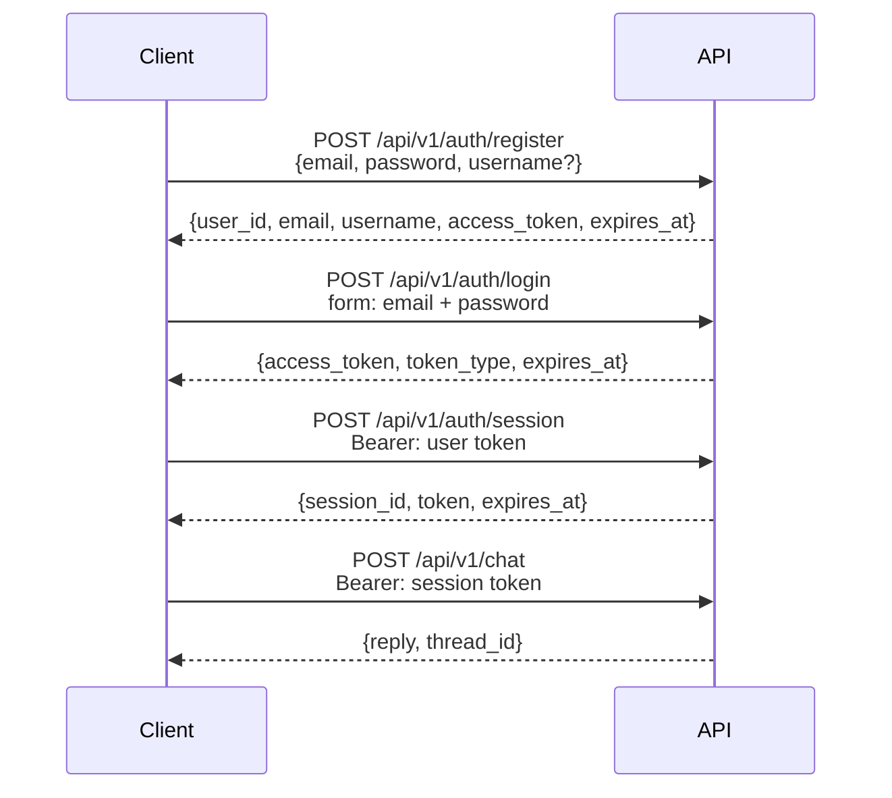

# Authentication

Status: live.
The JWT flow and the endpoints are implemented in `src/api/v1/auth.py:1`.
The scope guards live in `src/api/deps.py:1`.

## Where it lives

The HTTP layer lives in `src/api/v1/auth.py:1`.
The token guards live in `src/api/deps.py:1`.
The JWT configuration lives in `src/core/config.py:1`.
Hashing and JWT handling live in `src/core/security.py:1`.
Rate limiting lives in `src/core/limiter.py:1`.
The ORM models live in `src/models/:1`.
The Pydantic schemas live in `src/schemas/auth.py:1`.
The full layout is in `docs/structure.md:39`.
Never expose ORM models directly in the API.

## Flow



The API uses two token scopes.
The user token identifies the person and is used to create and list sessions.
The session token identifies one conversation and is required on chat endpoints.
Both are JWTs signed with HS256 and configurable expiration.
Chat validates the token by signature and pins the thread to the token `sid`.
A missing token returns 401, and a wrong scope returns 403.

## Endpoints

### `POST /api/v1/auth/register`

Creates a new account with email, password, and optional username.
Returns `200` with `user_id`, `email`, `username`, `access_token`, and `expires_at`.
The password requires 8 or more characters with uppercase, lowercase, digit, and symbol, and a weak password returns 422.
The email is normalized to lowercase, and a duplicate returns 409.
The username is copied to each session to personalize replies.

```json
{
  "email": "you@example.com",
  "password": "ChangeMe123!",
  "username": "you"
}
```

### `POST /api/v1/auth/login`

Exchanges credentials for a user token using the OAuth2 password grant shape.
Accepts `username` or `email` plus `password`, and uses `grant_type=password`.
Returns `200` with `access_token`, `token_type`, and `expires_at`.
Invalid credentials return 401 without revealing which field failed.

```bash
curl -X POST /api/v1/auth/login \
  -F "username=you@example.com" \
  -F "password=ChangeMe123!" \
  -F "grant_type=password"
```

### `POST /api/v1/auth/session`

Creates a new chat session and requires a valid user token.
Accepts an optional JSON body with `name`.
Returns `200` with `session_id`, a session-scoped `token`, and `expires_at`.
A missing token returns 401, and a session token returns 403.

```bash
curl -X POST /api/v1/auth/session \
  -H "Authorization: Bearer <user token>" \
  -H "Content-Type: application/json" \
  -d '{"name": "research"}'
```

### `PATCH /api/v1/auth/session/{session_id}/name`

Renames an existing session.
Requires the session token matching the path `session_id`.
A token from another session returns 403, and a missing session returns 404.

```bash
curl -X PATCH /api/v1/auth/session/{session_id}/name \
  -H "Authorization: Bearer <session token>" \
  -H "Content-Type: application/json" \
  -d '{"name": "My research session"}'
```

### `DELETE /api/v1/auth/session/{session_id}`

Deletes a session and its history row.
Requires the matching session token, with the same 403/404 rules as rename.
Returns `200` with `session_id` and `deleted: true`.

### `GET /api/v1/auth/sessions`

Lists only the sessions owned by the authenticated user.
Requires a valid user token, and a session token returns 403.

## Configuration

The signing key lives in `JWT_SECRET_KEY` inside `.env.example:10`.
The expiration in days lives in `JWT_ACCESS_TOKEN_EXPIRE_DAYS` inside `.env.example:11`.
Both are typed in `src/core/config.py:1`.
Use a long random value of at least 32 characters in production.
Never publish the contents of `.env:1`.

## Security notes

Passwords are stored with bcrypt hashes and never in plain text.
Each JWT includes a `jti` claim so every token is unique.
Register and login carry rate limits against brute force in `src/core/limiter.py:1`.
Budgets stay in memory per IP plus route (20 attempts per 60 seconds).
Errors use the same envelope `{error{code, message}, request_id}` with `X-Request-ID`.
