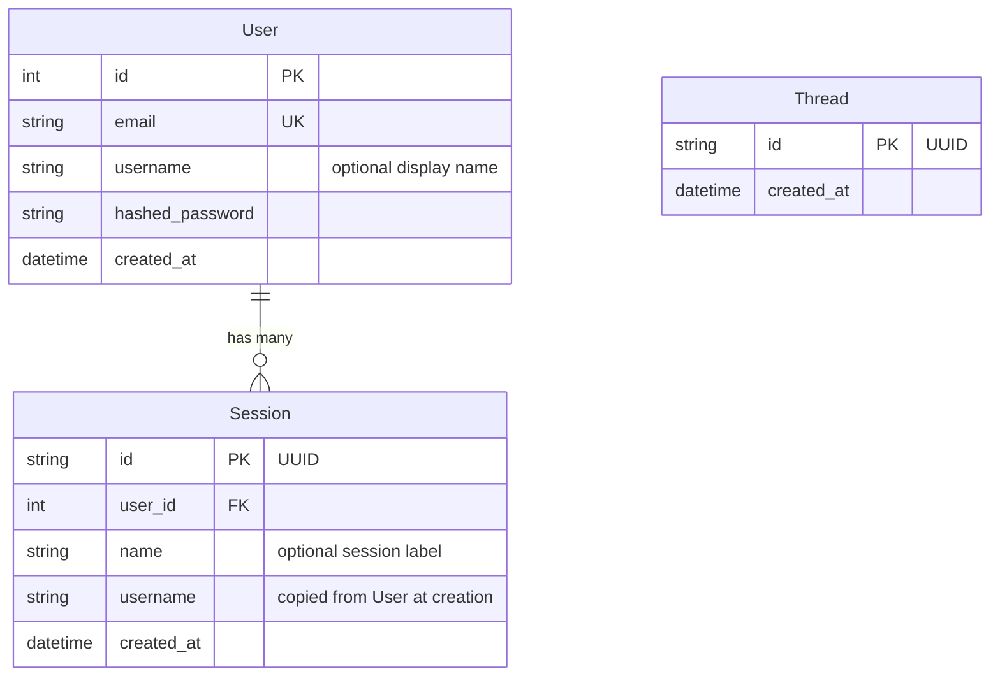

# Database

Estado: planeado.
El schema de app, las migraciones y pgvector aun no estan implementados.
Este documento describe el diseno objetivo adaptado a este starter.

## Donde vive

Los modelos ORM viviran en `ws/src/models/:1`.
El acceso a datos vivira en `ws/src/services/database.py:1`.
Las migraciones viviran en `ws/alembic/:1`.
La conexion local esta en `ws/docker-compose.yml:1`.
La URL de conexion esta en `ws/.env.example:5`.
El layout completo esta en `ws/docs/structure.md:49`.

## Schema planeado

User representa una cuenta con email unico.
Session representa una conversacion y un usuario puede tener muchas.
Session copia el username al crearse para evitar una lectura extra en cada chat.
Thread refleja el hilo de checkpoint de LangGraph en el contexto de la app.
Las tablas del checkpointer las gestiona LangGraph y no Alembic.
Esas tablas son `checkpoints`, `checkpoint_blobs` y `checkpoint_writes`.
La tabla de memoria semantica la gestiona la capa de memoria y tampoco Alembic.

## Checkpointer planeado

La persistencia usara `AsyncPostgresSaver` con un hilo por `thread_id`.
El grafo recibira el checkpointer por fabrica y nunca lo importara directo.
El patron objetivo es `make_the_agent(checkpointer)` segun `ws/docs/structure.md:128`.
El checkpointer se proveera como dependencia de lifespan desde `ws/src/services/database.py:1`.
Nunca guardes datos grandes en el estado porque quedan en los checkpoints.

## Migraciones con Alembic planeadas

Alembic sera dueno del schema de app.
La app nunca llamara a `create_all()` en el arranque.
Aplica las migraciones con `uv run alembic upgrade head`.
Genera una migracion con `uv run alembic revision --autogenerate -m "describe el cambio"`.
Revisa el archivo generado en `ws/alembic/versions/:1` antes de aplicarlo.
Retrocede una migracion con `uv run alembic downgrade -1`.
Muestra el historial con `uv run alembic history`.
Alembic leera la URL desde `ws/.env.example:5` via `ws/src/core/config.py:1`.
Los atajos de Makefile para migraciones estan planeados porque aun no existen.

### Como funciona autogenerate

El archivo `ws/alembic/env.py:1` importara todos los modelos para registrar sus metadatos.
Alembic comparara el schema de la base contra los modelos y generara upgrade y downgrade.
La funcion `include_object` en `ws/alembic/env.py:1` excluira tablas externas.
Las tablas excluidas seran las del checkpointer y las de memoria semantica.
Asi Alembic nunca tocara lo que gestionan LangGraph o la capa de memoria.

### Agregar un modelo nuevo

Crea el modelo en `ws/src/models/:1`.
Importalo en `ws/alembic/env.py:1` junto a los demas modelos.
Genera la migracion con `uv run alembic revision --autogenerate -m "add your_model table"`.
Aplica la migracion con `uv run alembic upgrade head`.

## Postgres y pgvector

El servicio local esta definido en `ws/docker-compose.yml:1`.
Hoy usa `postgres:15-alpine` sin extension vectorial.
El cambio a una imagen con pgvector esta planeado.
La extension se habilitara con `CREATE EXTENSION IF NOT EXISTS vector` antes de migrar.
Con Docker ese paso sera automatico en el servicio de base de datos.
En bases externas habilita la extension desde el panel o el editor SQL.
La memoria semantica de largo plazo usara pgvector y vive en `ws/src/services/memory.py:1`.
Esa capa aun no existe y tambien esta planeada.
