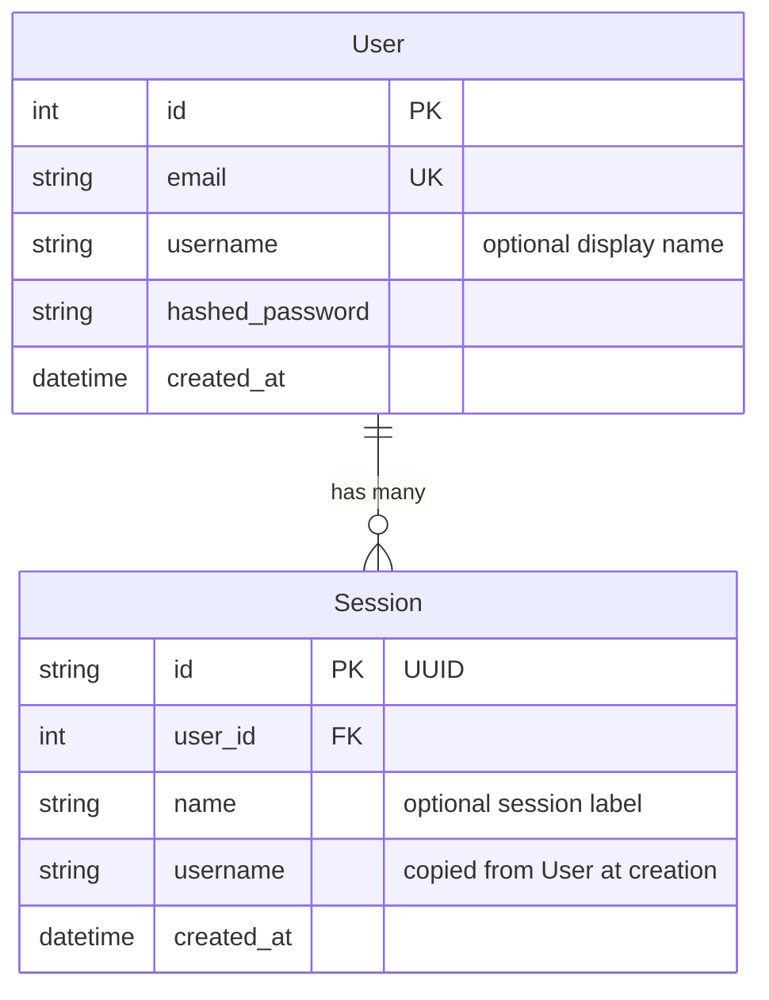

# Database

Estado: implementado en S2a.
El schema de app, las migraciones y el checkpointer ya existen.
pgvector sigue planeado para la memoria en el ticket #5.

## Donde vive

Los modelos ORM viven en `ws/src/models/:1`.
El acceso a datos vive en `ws/src/services/database.py:1`.
Las migraciones viven en `ws/alembic/:1`.
La conexion local esta en `ws/docker-compose.yml:1`.
La URL de conexion esta en `ws/.env.example:5`.
El layout completo esta en `ws/docs/structure.md:22`.

## Schema

User representa una cuenta con email unico.
Session representa una conversacion y un usuario puede tener muchas.
Session copia el username al crearse para evitar una lectura extra en cada chat.
No hay tabla Thread de app: el `thread_id` del loop vive en la tabla `checkpoints` que gestiona LangGraph.
Las tablas del checkpointer las gestiona LangGraph y no Alembic.
Esas tablas son `checkpoints`, `checkpoint_blobs` y `checkpoint_writes`.
La tabla de memoria semantica la gestionara la capa de memoria y tampoco Alembic.

## Checkpointer

La persistencia usa `AsyncPostgresSaver` con un hilo por `thread_id`.
El grafo recibe el checkpointer por fabrica y nunca lo importa directo.
La fabrica es `make_the_agent(checkpointer)` segun `ws/docs/structure.md:132`.
El checkpointer se provee como dependencia de lifespan desde `ws/src/services/database.py:1`.
El lifespan crea las tablas del checkpointer con `setup()` y compila el grafo una vez.
Sin `POSTGRES_URI` el estado es `not_configured` y con caida es `unavailable`; en ambos el chat sigue sin persistencia.
`GET /health` reporta ese estado en `dependencies.store`.
Nunca guardes datos grandes en `GraphState` porque quedan en los checkpoints.
`GraphState` en `ws/src/agent/state.py:1` usa `MessagesState` solo con `messages`.
Las tools `get_availability`, `book_appointment` y `get_order_status` viven en `ws/src/agent/tools/booking.py:1`.

## Migraciones con Alembic

Alembic es dueno del schema de app.
La migracion `0001_create_users_sessions` crea `users` y `sessions`.
La app nunca llama a `create_all()` en el arranque.
Aplica las migraciones con `uv run alembic upgrade head` o `make migrate`.
Genera una migracion con `uv run alembic revision --autogenerate -m "describe el cambio"`.
Revisa el archivo generado en `ws/alembic/versions/:1` antes de aplicarlo.
Retrocede una migracion con `uv run alembic downgrade -1`.
Muestra el historial con `uv run alembic history` o `make migrate_history`.
Alembic lee la URL desde `ws/.env.example:5` via `POSTGRES_URI` o `ws/src/core/config.py:1`.
Los atajos de Makefile para migraciones son `migrate` y `migrate_history`.

### Como funciona autogenerate

El archivo `ws/alembic/env.py:1` importa todos los modelos para registrar sus metadatos.
Alembic compara el schema de la base contra los modelos y genera upgrade y downgrade.
La funcion `include_object` en `ws/alembic/env.py:1` excluye tablas externas.
Las tablas excluidas son las del checkpointer y las de memoria semantica.
Asi Alembic nunca toca lo que gestionan LangGraph o la capa de memoria.

### Agregar un modelo nuevo

Crea el modelo en `ws/src/models/:1`.
Importalo en `ws/alembic/env.py:1` junto a los demas modelos.
Genera la migracion con `uv run alembic revision --autogenerate -m "add your_model table"`.
Aplica la migracion con `uv run alembic upgrade head`.

## Postgres y pgvector

El servicio local esta definido en `ws/docker-compose.yml:1`.
Hoy usa `postgres:15-alpine` sin extension vectorial.
El cambio a una imagen con pgvector queda diferido al ticket #5 de memoria.
La extension se habilitara con `CREATE EXTENSION IF NOT EXISTS vector` antes de migrar.
Con Docker ese paso sera automatico en el servicio de base de datos.
En bases externas habilita la extension desde el panel o el editor SQL.
La memoria semantica de largo plazo usara pgvector y vive en `ws/src/services/memory.py:1`.
Esa capa aun no existe y sigue planeada.
