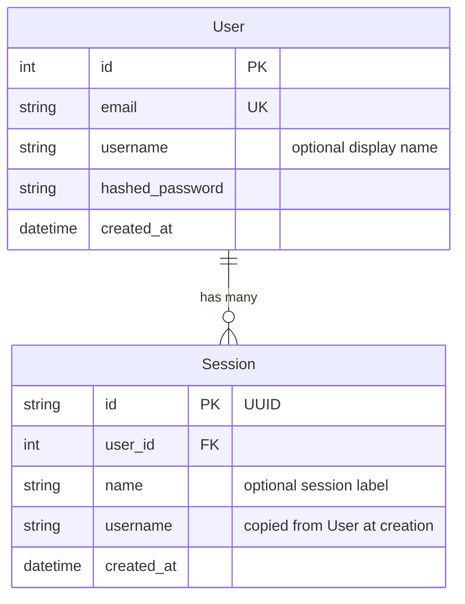

# Database

Estado: parcial.
El checkpointer por fabrica, las migraciones con frontera, el schema de app y la memoria S2b ya existen.
La extraccion LLM y auth siguen planeados.
Este documento describe el diseno objetivo adaptado a este starter.

## Donde vive

Los modelos ORM viven en `src/models/:1`.
El acceso a datos vive en `src/services/database.py:1`.
Las migraciones viven en `alembic/:1`.
La conexion local esta en `docker-compose.yml:1`.
La URL de conexion esta en `.env.example:5`.
El layout completo esta en `docs/structure.md:22`.

## Schema

User representa una cuenta con email unico.
Session representa una conversacion y un usuario puede tener muchas.
Session copia el username al crearse para evitar una lectura extra en cada chat.
Thread no tiene tabla de app: el hilo vive en el checkpointer y se mapeara a Session en el slice de auth.
Las tablas del checkpointer las gestiona LangGraph y no Alembic.
Esas tablas son `checkpoints`, `checkpoint_blobs`, `checkpoint_writes` y `checkpoint_migrations`.
La tabla de memoria semantica `memory_vectors` la gestiona la capa de memoria y tampoco Alembic.

## Checkpointer

La persistencia usa `AsyncPostgresSaver` con un hilo por `thread_id`.
El grafo recibe el checkpointer por fabrica y nunca lo importa directo.
El patron es `make_the_agent(checkpointer)` segun `docs/structure.md:140`.
El checkpointer se provee como dependencia de lifespan desde `src/services/database.py:1`.
Sin `POSTGRES_URI` el loop sigue efimero; con la variable puesta el arranque falla si el store no responde.
Nunca guardes datos grandes en `GraphState` porque quedan en los checkpoints.
`GraphState` en `src/agent/state.py:1` usa `MessagesState` con `messages` mas lista pequena `docs`.
Las tools `get_availability`, `book_appointment` y `get_order_status` viven en `src/agent/tools/booking.py:1`.

## Migraciones con Alembic

Alembic es dueno del schema de app.
La app nunca llama a `create_all()` en el arranque.
Aplica las migraciones con `uv run alembic upgrade head`.
Genera una migracion con `uv run alembic revision --autogenerate -m "describe el cambio"`.
Revisa el archivo generado en `alembic/versions/:1` antes de aplicarlo.
Retrocede una migracion con `uv run alembic downgrade -1`.
Muestra el historial con `uv run alembic history`.
Alembic lee la URL desde `.env.example:5` via `src/core/config.py:1`.
Los atajos `db-upgrade`, `db-revision`, `db-downgrade` y `db-history` viven en el `Makefile`.

### Como funciona autogenerate

El archivo `alembic/env.py:1` importara todos los modelos para registrar sus metadatos.
Alembic comparara el schema de la base contra los modelos y generara upgrade y downgrade.
La funcion `include_object` en `alembic/env.py:1` excluira tablas externas.
Las tablas excluidas seran las del checkpointer y las de memoria semantica.
Asi Alembic nunca tocara lo que gestionan LangGraph o la capa de memoria.

### Agregar un modelo nuevo

Crea el modelo en `src/models/:1`.
Importalo en `alembic/env.py:1` junto a los demas modelos.
Genera la migracion con `uv run alembic revision --autogenerate -m "add your_model table"`.
Aplica la migracion con `uv run alembic upgrade head`.

## Postgres y pgvector

El servicio local esta definido en `docker-compose.yml:1`.
Usa `pgvector/pgvector:pg15` con extension vectorial mas Valkey en `6379`.
La extension se habilitara con `CREATE EXTENSION IF NOT EXISTS vector` antes de migrar.
Con Docker ese paso sera automatico en el servicio de base de datos.
En bases externas habilita la extension desde el panel o el editor SQL.
La memoria semantica de largo plazo usa pgvector y vive en `src/services/memory.py:1`.
El frente de cache vive en `src/core/cache.py:1` con fallback in-memory.
