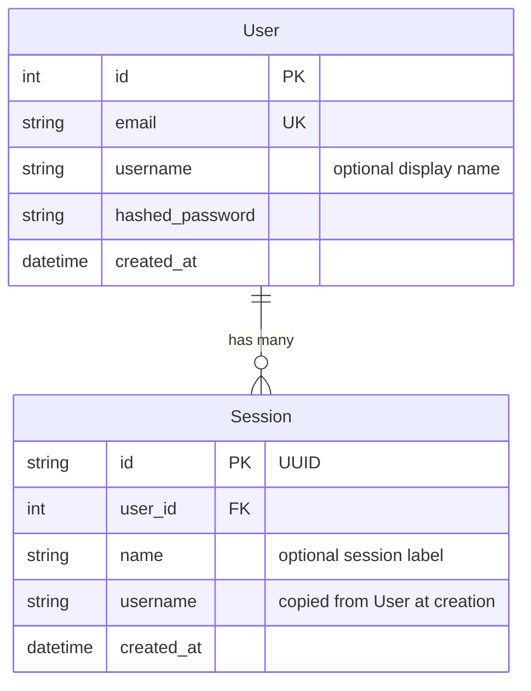

# Database

Status: implemented in S2a.
The app schema, the migrations, and the checkpointer already exist.
pgvector remains planned for memory under ticket #5.

## Where it lives

The ORM models live in `ws/src/models/:1`.
Data access lives in `ws/src/services/database.py:1`.
Migrations live in `ws/alembic/:1`.
The local connection is in `ws/docker-compose.yml:1`.
The connection URL is in `ws/.env.example:5`.
The full layout is in `ws/docs/structure.md:22`.

## Schema

User represents one account with a unique email.
Session represents one conversation, and one user can own many.
Session copies the username at creation to avoid one extra read on each chat.
There is no app Thread table: the loop `thread_id` lives in the `checkpoints` table managed by LangGraph.
The checkpointer tables are managed by LangGraph and not by Alembic.
Those tables are `checkpoints`, `checkpoint_blobs`, and `checkpoint_writes`.
The semantic memory table is managed by the memory layer and not by Alembic either.

## Checkpointer

Persistence uses `AsyncPostgresSaver` with one thread per `thread_id`.
The graph receives the checkpointer through a factory and never imports it directly.
The factory is `make_the_agent(checkpointer)` per `ws/docs/structure.md:132`.
The checkpointer is provided as a lifespan dependency from `ws/src/services/database.py:1`.
The lifespan creates the checkpointer tables with `setup()` and compiles the graph once.
Without `POSTGRES_URI` the state is `not_configured`, and on failure it is `unavailable`, and chat keeps running without persistence in both cases.
`GET /health` reports that state in `dependencies.store`.
Never store large payloads in `GraphState` because they persist inside checkpoints.
`GraphState` in `ws/src/agent/state.py:1` uses `MessagesState` with `messages` only.
The `get_availability`, `book_appointment`, and `get_order_status` tools live in `ws/src/agent/tools/booking.py:1`.

## Migrations with Alembic

Alembic owns the app schema.
The `0001_create_users_sessions` migration creates `users` and `sessions`.
The app never calls `create_all()` at startup.
Apply migrations with `uv run alembic upgrade head` or `make migrate`.
Generate a migration with `uv run alembic revision --autogenerate -m "describe the change"`.
Review the generated file in `ws/alembic/versions/:1` before applying it.
Roll back one migration with `uv run alembic downgrade -1`.
Show history with `uv run alembic history` or `make migrate_history`.
Alembic reads the URL from `ws/.env.example:5` through `POSTGRES_URI` or `ws/src/core/config.py:1`.
The Makefile shortcuts for migrations are `migrate` and `migrate_history`.

### How autogenerate works

The `ws/alembic/env.py:1` file imports every model to register its metadata.
Alembic compares the database schema against the models and generates upgrade and downgrade.
The `include_object` function in `ws/alembic/env.py:1` excludes external tables.
The excluded tables are the checkpointer tables and the semantic memory tables.
So Alembic never touches what LangGraph or the memory layer manages.

### Adding a new model

Create the model in `ws/src/models/:1`.
Import it in `ws/alembic/env.py:1` next to the other models.
Generate the migration with `uv run alembic revision --autogenerate -m "add your_model table"`.
Apply the migration with `uv run alembic upgrade head`.

## Postgres and pgvector

The local service is defined in `ws/docker-compose.yml:1`.
Today it uses `postgres:15-alpine` without a vector extension.
The move to a pgvector image stays deferred to the memory ticket #5.
The extension is enabled with `CREATE EXTENSION IF NOT EXISTS vector` before migrating.
Under Docker that step is automatic in the database service.
On external databases enable the extension from the dashboard or the SQL editor.
Long term semantic memory will use pgvector and lives in `ws/src/services/memory.py:1`.
That layer does not exist yet and remains planned.
