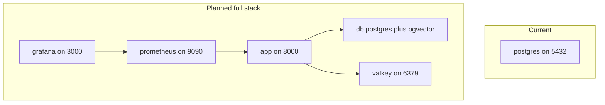

# Docker

Local postgres runs in compose today.
The full stack is planned.
This guide covers current use plus the target stack.

## Status

`ws/docker-compose.yml:1` defines one service today.
That service is postgres on port 5432.
It has no pgvector extension yet.
It has no cache or monitoring services yet.
See `ws/docs/structure.md:69` for the compose role.
See `ws/pyproject.toml:1` for the uv-only packaging setup.
See `ws/langgraph.json:1` for the graph and env pointer.



## Services

Postgres stores app data and checkpoints today.
It will later store vectors too.
Valkey is planned as a shared cache for memory search.
Prometheus is planned to scrape `GET /metrics`.
Grafana is planned to render latency and error dashboards.
A container metrics exporter is planned for system views.

Planned ports:

| Service | Port | Purpose |
| --- | --- | --- |
| app | 8000 | HTTP API |
| db | 5432 | Postgres data |
| valkey | 6379 | Shared cache |
| prometheus | 9090 | Metrics store |
| grafana | 3000 | Dashboards |

Only the postgres port is live today.

## Commands

Use compose directly for the current single service.
Use the `make` shortcuts where they exist.
All Python work stays uv-only.

```bash
cp .env.example .env
uv sync
docker compose up -d
docker compose logs -f
docker compose down
```

Planned shortcuts will wrap env files per stage.
Those shortcuts do not exist yet.
They will follow the `ws/Makefile:8` pattern.
Example target shape will be `docker-up` and `stack-up`.
Full stack will add Prometheus plus Grafana in one command.

Build a custom image only from the repo root.
Tag images per environment outside compose files.
Keep secrets out of image layers at all times.

## Environment files

Local dev uses one `.env` file today.
See `ws/.env.example:1` for the template.
`POSTGRES_URI` in `ws/.env.example:5` points at localhost today.
Docker networking will need `db` as host instead of localhost.
Each deploy stage will get its own env file when stack lands.
Copy the example file per stage and edit values there.
Never commit real keys to the repo.

Planned files:

```bash
cp .env.example .env.development
cp .env.example .env.staging
cp .env.example .env.production
```

## Volumes and data

Postgres data lives in a named volume.
See `ws/docker-compose.yml:11` for the volume mount.
The volume survives `docker compose down` by default.
Remove it explicitly only to reset local data.
Back up production data with managed backups instead.

## Monitoring

Metrics and dashboards are planned.
Prometheus config will live in `ws/prometheus/:1`.
Grafana files will live in `ws/grafana/:1`.
Both paths do not exist yet.
The app will expose `GET /metrics` for scraping.
See `ws/docs/observability.md:1` for metric names.
Start with postgres only until metrics land.

## Migrations

Migrations run with Alembic from the S2a slice.
The initial migration `0001_create_users_sessions` creates `users` and `sessions`.
Migrations run from the host against compose postgres.
They never touch checkpointer tables.
They never touch memory vector tables.
See `ws/docs/structure.md:183` for the migration boundary.

Flow with compose postgres:

```bash
docker compose up -d
make migrate
```

## What exists today

`ws/docker-compose.yml:1` starts postgres with fixed credentials.
`ws/Makefile:8` installs with `uv sync`.
`ws/Makefile:11` runs the dev server.
No app image exists yet.
No Valkey service exists yet.
No monitoring services exist yet.

## Next steps

Enable pgvector on the postgres image.
Add Valkey with fallback kept in code.
Add app service with uv-based image build.
Add Prometheus plus Grafana for local monitoring.
Add per-stage env files and stack shortcuts.
