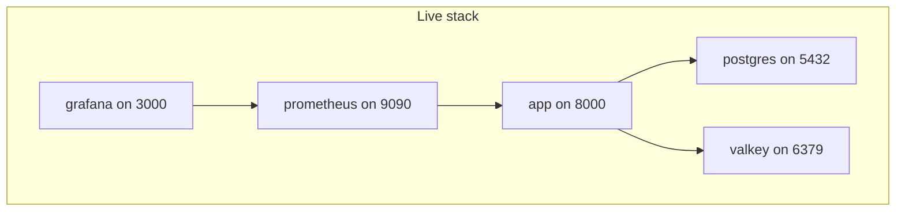

# Docker

Local postgres with pgvector plus Valkey run in compose.
The full stack with app plus metrics plus dashboards is live.
This guide covers the live stack plus per-stage env handling.

## Status

`ws/docker-compose.yml:1` defines five services today.
Postgres with pgvector runs on port 5432.
Valkey runs on port 6379 as the shared memory-search cache.
The app builds from `ws/Dockerfile:1` with uv and serves on port 8000.
Prometheus scrapes `GET /metrics` on port 9090.
Grafana renders dashboards on port 3000.
Application code keeps the in-memory fallback when Valkey is unreachable.
See `ws/docs/structure.md:69` for the compose role.
See `ws/pyproject.toml:1` for the uv-only packaging setup.
See `ws/langgraph.json:1` for the graph and env pointer.



## Services

Postgres stores app data, checkpoints, and vectors.
The image is `pgvector/pgvector:0.8.0-pg15` and the lifespan enables the `vector` extension.
Valkey is the shared cache for memory search with an in-memory fallback in code.
The app image builds with uv from the repo root and runs `uvicorn src.api.app:app`.
Prometheus scrapes `GET /metrics` via the `app:8000` target in `ws/prometheus/prometheus.yml:1`.
Grafana provisions the Prometheus datasource plus the latency-errors dashboard from `ws/grafana/:1`.
No container metrics exporter runs yet.

Live ports:

| Service | Port | Purpose |
| --- | --- | --- |
| app | 8000 | HTTP API |
| postgres | 5432 | Postgres data |
| valkey | 6379 | Shared cache |
| prometheus | 9090 | Metrics store |
| grafana | 3000 | Dashboards |

All five services are live.

## Commands

Use the `make` shortcuts for the common flows.
All Python work stays uv-only.

```bash
cp .env.example .env
uv sync
make docker-up
make stack-up
make stack-logs
make stack-down
```

`make docker-up` starts backing services only with `docker compose up -d postgres valkey`.
`make stack-up` builds and starts the full stack with `docker compose --env-file $(ENV_FILE) up -d --build`.
`make stack-down` stops the stack with `docker compose down`.
`make stack-logs` follows logs with `docker compose logs -f`.
Override the stage file per run without editing the Makefile.

```bash
make stack-up ENV_FILE=.env.staging
make stack-up ENV_FILE=.env.production
```

Build a custom image only from the repo root.
Tag images per environment outside compose files.
Keep secrets out of image layers at all times.
`ws/.dockerignore:1` excludes env files from the build context.
`ws/Dockerfile:1` copies only code plus lockfile, never `.env`.

## Environment files

Each deploy stage has its own committed env template.
See `ws/.env.example:1` for the local-dev template.
Local dev on the host uses `localhost` for the store and an empty `VALKEY_HOST` fallback.
Compose stages use service hostnames because containers share the compose network.
`POSTGRES_URI` uses `postgres` as host inside compose and `localhost` on the host.
`VALKEY_HOST` is `valkey` inside compose and empty or `localhost` on the host.
Copy the example file for host-local runs and pick a stage file for compose runs.
Never commit real keys to the repo.

Stage files:

```bash
cp .env.example .env
make stack-up ENV_FILE=.env.development
make stack-up ENV_FILE=.env.staging
make stack-up ENV_FILE=.env.production
```

| File | `APP_ENV` | `LOG_LEVEL` | `DEBUG` | Store host |
| --- | --- | --- | --- | --- |
| `.env.example` | development | INFO | false | localhost |
| `.env.development` | development | DEBUG | true | postgres |
| `.env.staging` | staging | INFO | false | postgres |
| `.env.production` | production | WARNING | false | postgres |

Stage files carry placeholder secrets only.
Production overrides real keys in the deploy environment instead.
`JWT_SECRET_KEY` must be rotated outside the repo before any real deploy.

## Volumes and data

Postgres data lives in a named volume.
See `ws/docker-compose.yml:11` for the volume mount.
The volume survives `docker compose down` by default.
Remove it explicitly only to reset local data.
Back up production data with managed backups instead.

## Monitoring

Metrics and dashboards are live.
Prometheus config lives in `ws/prometheus/:1`.
Grafana files live in `ws/grafana/:1`.
The app exposes `GET /metrics` for scraping.
See `ws/docs/observability.md:1` for metric names.
Grafana logs in with `admin` / `admin` locally and renders the latency-errors dashboard.
Change the Grafana password in the deploy environment for shared stages.

## Migrations

Migrations run with Alembic from the S2a slice.
The initial migration `0001_create_users_sessions` creates `users` and `sessions`.
Migrations run from the host against compose postgres.
They never touch checkpointer tables.
They never touch memory vector tables.
See `ws/docs/structure.md:183` for the migration boundary.

Flow with the stack:

```bash
make docker-up
make migrate
```

## What exists today

`ws/docker-compose.yml:1` starts the app plus pgvector postgres plus Valkey plus Prometheus plus Grafana.
`ws/Dockerfile:1` builds the app image with uv and keeps secrets out of layers.
`ws/Makefile:8` installs with `uv sync`.
`ws/Makefile:11` runs the dev server.
`make docker-up` starts backing services only.
`make stack-up` starts the full stack per stage file.
CI in `.github/workflows/ci.yml:1` gates lint plus unit plus journeys before merge.

## Next steps

Add a container metrics exporter for system views.
Add alert rules once latency baselines are known.
Document production secret provisioning outside the repo.
