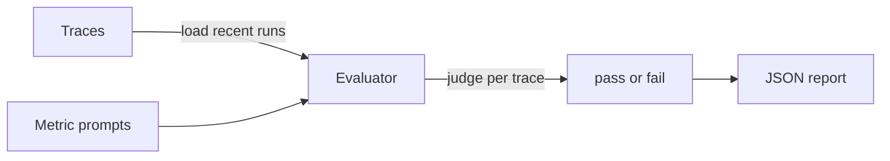

# Evaluation

The eval runner scores stored trajectories on demand.
It never runs with unit tests.
This guide describes how evals work in this starter.

## Status

Unit and integration layouts are already specified.
See `ws/docs/structure.md:195` for the test and eval contract.
Traces are the input for scoring.
Reports are plain JSON files on disk.
The runner lives at `ws/evals/eval_runner.py:1`.

## Overview

Evals score trajectories, not only final answers.
A trajectory includes intent, tool calls, and approvals.
Each production failure becomes a new eval case.
This stops the same bug from returning.



## Running evals

Evals run on demand with uv.
They never run as part of unit tests by default.
Use the runner with the buffer or a JSONL trace file.

```bash
make install
make test
make integration_tests
uv run python evals/eval_runner.py
make eval
```

Unit tests cover nodes and routes with fake models.
Integration tests call real models on purpose.
Evals cover full trajectories from stored traces.

Input resolution in order:

1. `--traces-file path.jsonl` when the flag points to a file with records.
2. `TRACE_LOG_PATH` when the env value points to a file with records.
3. The in-memory buffer through `recent_traces` plus `to_eval_record`.

The trace file uses one JSON object per line.
Stored `inputs` normalize to eval `input` automatically.
Use `--limit 50` to cap the run.
Use `--no-cases` to skip failure case output.
Use `--reports-dir` plus `--cases-dir` to redirect output.

## Built-in metrics

These five metrics are the default set.

| Metric | Checks |
| --- | --- |
| helpfulness | Response helped the user |
| conciseness | Response length fit the task |
| hallucination | Response avoided made-up facts |
| relevancy | Response stayed on topic |
| toxicity | Response avoided harmful content |

Each metric has one prompt file.
Prompts live under `ws/evals/metrics/prompts/:1`.
The runner discovers every markdown file by stem.
No runner change is needed for a new metric.

## Adding a custom metric

Create one markdown file per metric in the prompts folder.
Describe what passes and what fails in plain words.
The runner discovers every markdown file automatically.
Keep each prompt short and focused on one property.
Review new metrics with one failing example first.

Example prompt file layout:

```markdown
# My Metric

Evaluate one property of the assistant response.
Return pass when the property holds.
Return fail when the property is missing.
```

## Report format

Reports are saved under `ws/evals/reports/:1`.
Each file uses a timestamped JSON name.
The top level shows totals and success rate.
The metrics block shows pass counts per metric.
The traces block keeps per-trace detail for review.

Example report shape:

```json
{
  "generated_at": "2026-10-16T00:00:00+00:00",
  "total_traces": 50,
  "total_checks": 250,
  "passed_checks": 230,
  "failed_checks": 20,
  "success_rate": 0.92,
  "duration_seconds": 34.2,
  "judge_model": "heuristic",
  "metrics": {
    "helpfulness": {"pass": 48, "fail": 2, "rate": 0.96}
  },
  "traces": [
    {
      "trace_id": "abc123",
      "passed": false,
      "failures": ["helpfulness"],
      "results": {"helpfulness": "fail"}
    }
  ]
}
```

Failing traces also save one JSON case each under `ws/evals/cases/:1`.
Each case keeps the trace id, the failure list, and the full record.
Add a failing case to the regression set to stop repeats.

## Eval model configuration

The judge uses its own model setting.
The default judge is an offline heuristic with no network calls.
It passes when the trajectory has intent text plus output text and no error.
Configure a future model judge with env vars only.
Do not hardcode keys or model names in code.
See `ws/.env.example:1` for the pattern to follow.

```bash
EVALUATION_LLM=heuristic
```

The report records the judge label in `judge_model`.
The runner reads `EVALUATION_LLM` when present.

## What exists today

`ws/Makefile:14` runs unit tests with uv.
`ws/Makefile:17` runs integration tests with uv.
`ws/Makefile:20` runs trajectory evals with uv.
`ws/pyproject.toml:29` sets `tests` as the test path.
The eval runner exists at `ws/evals/eval_runner.py:1`.
The five default prompts exist under `ws/evals/metrics/prompts/:1`.
Reports land under `ws/evals/reports/:1` and stay ignored by git.

## Next steps

Turn each production failure into one new eval case.
Link traces from `ws/docs/observability.md:1` as eval input.
Swap the heuristic judge for a model judge behind `EVALUATION_LLM`.
