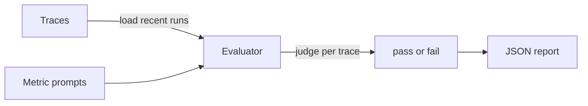

# Evaluation

The eval framework is planned.
It is not implemented yet.
This guide describes how evals will work in this starter.

## Status

Unit and integration layouts are already specified.
See `docs/structure.md:201` for the test and eval contract.
Traces will be the input for scoring.
Reports will be plain JSON files on disk.
The runner path will be `evals/eval_runner.py:1`.
That path does not exist yet.

## Overview

Evals will score trajectories, not only final answers.
A trajectory includes intent, tool calls, and approvals.
Each production failure will become a new eval case.
This will stop the same bug from returning.



## Running evals

Evals will run on demand with uv.
They will never run as part of unit tests by default.
Use the planned runner once `evals/eval_runner.py:1` exists.

Planned commands once `evals/eval_runner.py:1` exists:

```bash
make install
make test
make integration_tests
uv run python evals/eval_runner.py
```

Unit tests will cover nodes and routes with fake models.
Integration tests will call real models on purpose.
Evals will cover full trajectories from stored traces.

## Built-in metrics

These five metrics are the planned default set.

| Metric | Checks |
| --- | --- |
| helpfulness | Response helped the user |
| conciseness | Response length fit the task |
| hallucination | Response avoided made-up facts |
| relevancy | Response stayed on topic |
| toxicity | Response avoided harmful content |

Each metric will have one prompt file.
Prompts will live under `evals/metrics/prompts/:1`.
That folder is planned and does not exist yet.

## Adding a custom metric

Create one markdown file per metric in the prompts folder.
Describe what passes and what fails in plain words.
The runner will discover every markdown file automatically.
Keep each prompt short and focused on one property.
Review new metrics with one failing example first.

Example prompt file layout:

```markdown
# My Metric

Evaluate one property of the assistant response.
Return pass when the property holds.
Return fail when the property is missing.
```

## Report format

Reports will be saved under `evals/reports/:1`.
That folder is planned and does not exist yet.
Each file will use a timestamped JSON name.
The summary will show totals and success rate.
The metrics block will show pass counts per metric.
The traces block will keep per-trace detail for review.

Example report shape:

```json
{
  "summary": {
    "total_traces": 50,
    "success_rate": 0.92,
    "duration_seconds": 34.2
  },
  "metrics": {
    "helpfulness": {"pass": 48, "fail": 2, "rate": 0.96}
  }
}
```

## Eval model configuration

The judge will use its own model setting.
This will allow a cheaper model than the agent default.
Configure it with env vars only.
Do not hardcode keys or model names in code.
See `.env.example:1` for the pattern to follow.

Planned vars:

```bash
EVALUATION_LLM=gpt-5
EVALUATION_API_KEY=
```

The key will default to `OPENAI_API_KEY` when empty.

## What exists today

`Makefile:14` runs unit tests with uv.
`Makefile:17` runs integration tests with uv.
`pyproject.toml:34` sets `tests` as the test path.
No eval runner exists yet.
No metric prompts exist yet.
No report folder exists yet.

## Next steps

Add `evals/eval_runner.py` for fetch, score, and report steps.
Add `evals/metrics/prompts/` with the five default metrics.
Add `evals/reports/` to output ignored JSON reports.
Turn each production failure into one new eval case.
Link traces from `docs/observability.md:1` as eval input.
