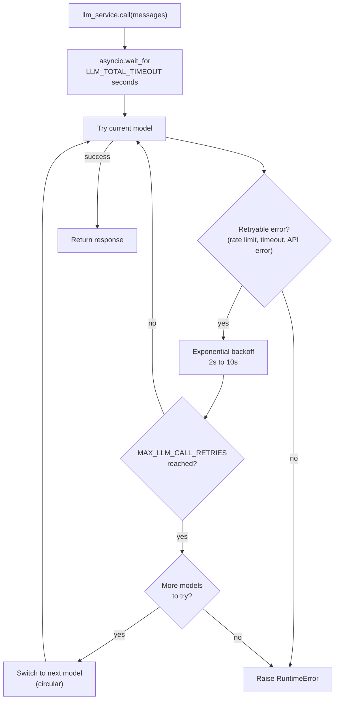

# LLM Service

Estado: existe.
El registry, los reintentos y el fallback estan implementados en `src/services/llm/`.
Sin claves el loop usa el echo fallback para que el clon fresco siga verde.

## Donde vive

El registry vive en `src/services/llm/registry.py:1`.
La logica de llamada vive en `src/services/llm/service.py:1`.
El layout de servicios esta en `docs/structure.md:177`.
El modelo inicial sale de `DEFAULT_LLM_MODEL` en `src/core/config.py:1`.
Las claves de proveedor estan en `.env.example:1`.
El codigo del agente llamara a `llm_service.call(messages)` y el servicio hara el resto.
`messages` viene de `GraphState` en `src/agent/state.py:1` que usa `MessagesState` con lista pequena `docs`.

## Registry

Los modelos se definen en orden de preferencia en `src/services/llm/registry.py:1`.
El modelo inicial se elige con `DEFAULT_LLM_MODEL` en `src/core/config.py:1`.
Para agregar o cambiar modelos edita la lista del registry.

| Name | Provider | Notes |
| ---- | -------- | ----- |
| `default-openai` | OpenAI | Primary model, uses `OPENAI_API_KEY` |
| `fallback-anthropic` | Anthropic | First fallback, uses `ANTHROPIC_API_KEY` |
| `fallback-google` | Google | Second fallback, uses `GOOGLE_API_KEY` |

Las claves ya existen en `.env.example:1`.
El orden de la lista define el orden del fallback.
El nombre elegido en `DEFAULT_LLM_MODEL` define por donde empieza el ciclo.

## Reintentos y fallback circular



Cada modelo reintenta con backoff exponencial entre 2 y 10 segundos.
El maximo de intentos por modelo es `MAX_LLM_CALL_RETRIES` con valor 3.
Solo se reintentan errores de rate limit, timeout y errores de API.
Un presupuesto total de `LLM_TOTAL_TIMEOUT_SECONDS` con valor 60 segundos limita todo el ciclo.
Sin ese presupuesto el peor caso sumaria reintentos por modelos por esperas y superaria los 2 minutos.
El fallback recorre la lista en orden circular desde `DEFAULT_LLM_MODEL` y se detiene tras un ciclo completo.
Si ningun modelo responde el servicio lanza `RuntimeError` con prefijo `MODEL_UNAVAILABLE`.

## Tools

El nodo chat pasa la lista compartida en cada llamada con `llm_service.acall(messages, tools)`.
Las tools del agente viven en `src/agent/tools/:1` segun `docs/structure.md:150`.
Son `get_availability`, `book_appointment` y `get_order_status` desde `src/agent/tools/booking.py:1`.
Al cambiar de modelo en un fallback las tools se reasocian al modelo nuevo.
Ese reasociado es automatico dentro de `src/services/llm/service.py:1`.
El grafo se construye con `make_the_agent(checkpointer, ..., llm)` con `AsyncPostgresSaver` por `thread_id` segun `docs/structure.md:140`.
Las tablas `checkpoints`, `checkpoint_blobs` y `checkpoint_writes` las gestiona LangGraph y no Alembic.
La memoria de largo plazo vive en `src/services/memory.py:1` y no cambia el fallback.

## Structured output

Pasa un modelo Pydantic como `response_format` para recibir una instancia validada.
Sin `response_format` el servicio devuelve el mensaje base sin validar.

```python
result = await llm_service.acall(
    messages,
    tools,
    response_format=MySchema,
)
```

El servicio encadena `with_structured_output(schema)` sobre el modelo resuelto.
Ese encadenado solo aplica como paso terminal, nunca dentro del loop de tools.
Asi los reintentos y el fallback funcionan sin codigo extra en el agente.

## Agregar un modelo nuevo

Agrega la entrada en la lista de `src/services/llm/registry.py:1`.
La posicion en la lista define cuando entra en el fallback.
Usa la API key del proveedor desde `src/core/config.py:1`.

```python
{
    "name": "fallback-google",
    "llm": ChatGoogleGenerativeAI(
        model="gemini-2.5-flash",
        api_key=settings.GOOGLE_API_KEY,
    ),
},
```

Verifica el cambio con `uv run pytest`.
Corre el lint con `uv run ruff check src/` segun `Makefile:23`.
