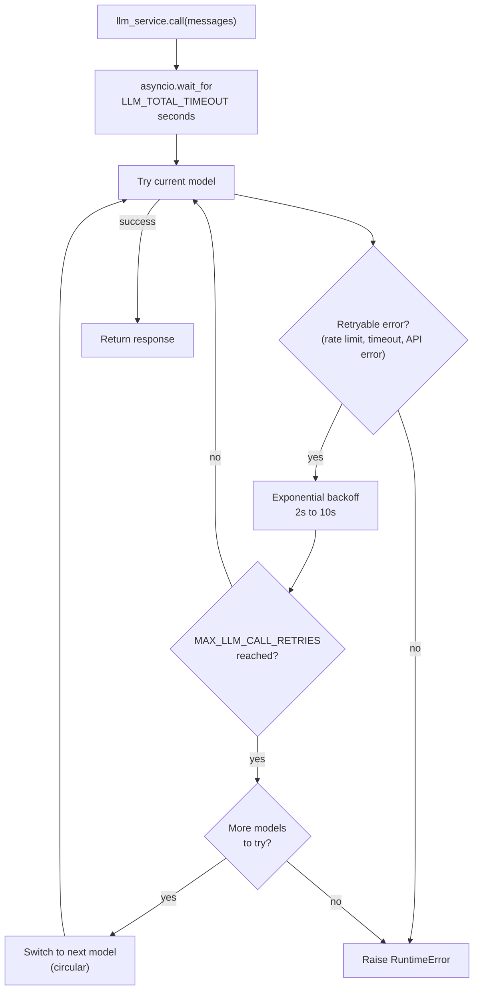

# LLM Service

Status: implemented.
The registry, the retries, and the fallback are live behind `llm_service.call`.
This document describes the implemented design adapted to this starter.

## Where it lives

The registry lives in `ws/src/services/llm/registry.py:1`.
The call logic lives in `ws/src/services/llm/service.py:1`.
The service layout is in `ws/docs/structure.md:51`.
The model per context is declared in `ws/src/agent/configuration.py:1`.
The provider keys are in `ws/.env.example:1`.
Agent code calls `llm_service.call(messages)` and the service handles the rest.
`messages` comes from `GraphState` in `ws/src/agent/state.py:1`, which uses `MessagesState` with a small `docs` list.

## Planned registry

Models are defined in preference order in `ws/src/services/llm/registry.py:1`.
The starting model is selected with `DEFAULT_LLM_MODEL` in `ws/src/core/config.py:1`.
To add or change models edit the registry list.

| Name | Provider | Notes |
| ---- | -------- | ----- |
| `default-openai` | OpenAI | Primary model, uses `OPENAI_API_KEY` |
| `fallback-anthropic` | Anthropic | First fallback, uses `ANTHROPIC_API_KEY` |
| `fallback-google` | Google | Second fallback, uses `GOOGLE_API_KEY` |

The keys already exist in `ws/.env.example:1`.
The list order defines the fallback order.
The name selected in `DEFAULT_LLM_MODEL` defines where the cycle starts.

## Circular retries and fallback



Each model retries with exponential backoff between 2 and 10 seconds.
The maximum attempts per model is `MAX_LLM_CALL_RETRIES` with value 3.
Only rate limit, timeout, and API errors are retried.
Non-retryable errors fail fast without moving to the next model.
A total budget of `LLM_TOTAL_TIMEOUT` with value 60 seconds bounds the whole cycle.
Without that budget the worst case would add retries times models times waits and would exceed 2 minutes.
Fallback walks the list in circular order and stops after one full cycle.
Models without a key or without a package are skipped with a log warning.
When no model answers the service raises `RuntimeError`.

## Tools

Tools are registered once at startup with `llm_service.bind_tools(tools)`.
The agent tools live in `ws/src/agent/tools/:1` per `ws/docs/structure.md:142`.
They are `get_availability`, `book_appointment`, and `get_order_status` from `ws/src/agent/tools/booking.py:1`.
On a fallback model switch the tools are rebound to the new model.
That rebinding is automatic inside `ws/src/services/llm/service.py:1`.
The graph is built with `make_the_agent(checkpointer)` with `AsyncPostgresSaver` per `thread_id` per `ws/docs/structure.md:132`.
The `checkpoints`, `checkpoint_blobs`, and `checkpoint_writes` tables are managed by LangGraph and not by Alembic.
Long term memory lives in `ws/src/services/memory.py:1` and does not change the fallback.

## Structured output

Pass a Pydantic model as `response_format` to receive a validated instance.
Without `response_format` the service returns the base message without validation.

```python
result = await llm_service.call(
    messages,
    model_name="fallback-anthropic",
    response_format=MySchema,
    temperature=0.2,
)
```

The service chains `with_structured_output(schema)` over the resolved model.
That chaining repeats on every retry and on every model switch.
So retries and fallback work with no extra code in the agent.

## Provider packages

The registry imports each chat model lazily.
Install the provider package before using its model.

| Model | Package | Class |
| ---- | ------- | ----- |
| `default-openai` | `langchain-openai` | `ChatOpenAI` (`gpt-4o-mini`) |
| `fallback-anthropic` | `langchain-anthropic` | `ChatAnthropic` (`claude-sonnet-4-5-20250929`) |
| `fallback-google` | `langchain-google-genai` | `ChatGoogleGenerativeAI` (`gemini-2.5-flash`) |

Without the package or without the key the model is skipped from the cycle with a warning.

## Adding a new model

Add the entry in the `ws/src/services/llm/registry.py:1` list.
The position in the list defines when it enters the fallback.
Use the provider API key from `ws/src/core/config.py:1`.

```python
{
    "name": "fallback-google",
    "llm": ChatGoogleGenerativeAI(
        model="gemini-2.5-flash",
        api_key=settings.GOOGLE_API_KEY,
    ),
},
```

Verify the change with `uv run pytest`.
Run lint with `uv run ruff check src/` per `ws/Makefile:23`.
