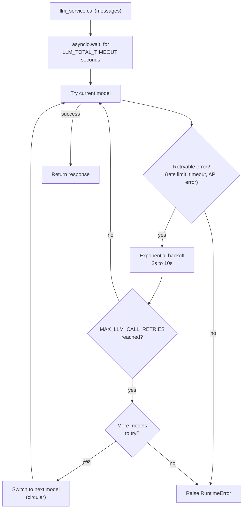

# LLM Service

Estado: implementado.
El registry, los reintentos y el fallback estan en vivo detras de `llm_service.call`.
Este documento describe el diseno implementado adaptado a este starter.

## Donde vive

El registry vive en `ws/src/services/llm/registry.py:1`.
La logica de llamada vive en `ws/src/services/llm/service.py:1`.
El layout de servicios esta en `ws/docs/structure.md:51`.
El modelo por contexto se declara en `ws/src/agent/configuration.py:1`.
Las claves de proveedor estan en `ws/.env.example:1`.
El codigo del agente llama a `llm_service.call(messages)` y el servicio se encarga del resto.
`messages` viene de `GraphState` en `ws/src/agent/state.py:1` que usa `MessagesState` con lista pequena `docs`.

## Registry planeado

Los modelos se definen en orden de preferencia en `ws/src/services/llm/registry.py:1`.
El modelo inicial se elige con `DEFAULT_LLM_MODEL` en `ws/src/core/config.py:1`.
Para agregar o cambiar modelos edita la lista del registry.

| Name | Provider | Notes |
| ---- | -------- | ----- |
| `default-openai` | OpenAI | Primary model, uses `OPENAI_API_KEY` |
| `fallback-anthropic` | Anthropic | First fallback, uses `ANTHROPIC_API_KEY` |
| `fallback-google` | Google | Second fallback, uses `GOOGLE_API_KEY` |

Las claves ya existen en `ws/.env.example:1`.
El orden de la lista define el orden del fallback.
El nombre elegido en `DEFAULT_LLM_MODEL` define por donde empieza el ciclo.

## Reintentos y fallback circular



Cada modelo reintenta con backoff exponencial entre 2 y 10 segundos.
El maximo de intentos por modelo es `MAX_LLM_CALL_RETRIES` con valor 3.
Solo se reintentan errores de rate limit, timeout y errores de API.
Los errores no reintentables fallan rapido sin pasar al siguiente modelo.
Un presupuesto total de `LLM_TOTAL_TIMEOUT` con valor 60 segundos limita todo el ciclo.
Sin ese presupuesto el peor caso sumaria reintentos por modelos por esperas y superaria los 2 minutos.
El fallback recorre la lista en orden circular y se detiene tras un ciclo completo.
Los modelos sin clave o sin paquete se omiten con un aviso en el log.
Si ningun modelo responde el servicio lanza `RuntimeError`.

## Tools

Las tools se registran una vez al arrancar con `llm_service.bind_tools(tools)`.
Las tools del agente viven en `ws/src/agent/tools/:1` segun `ws/docs/structure.md:142`.
Son `get_availability`, `book_appointment` y `get_order_status` desde `ws/src/agent/tools/booking.py:1`.
Al cambiar de modelo en un fallback las tools se reasocian al modelo nuevo.
Ese reasociado es automatico dentro de `ws/src/services/llm/service.py:1`.
El grafo se construye con `make_the_agent(checkpointer)` con `AsyncPostgresSaver` por `thread_id` segun `ws/docs/structure.md:132`.
Las tablas `checkpoints`, `checkpoint_blobs` y `checkpoint_writes` las gestiona LangGraph y no Alembic.
La memoria de largo plazo vive en `ws/src/services/memory.py:1` y no cambia el fallback.

## Structured output

Pasa un modelo Pydantic como `response_format` para recibir una instancia validada.
Sin `response_format` el servicio devuelve el mensaje base sin validar.

```python
result = await llm_service.call(
    messages,
    model_name="fallback-anthropic",
    response_format=MySchema,
    temperature=0.2,
)
```

El servicio encadena `with_structured_output(schema)` sobre el modelo resuelto.
Ese encadenado se repite en cada reintento y en cada cambio de modelo.
Asi los reintentos y el fallback funcionan sin codigo extra en el agente.

## Paquetes de proveedor

El registry importa cada chat model de forma diferida.
Instala el paquete del proveedor antes de usar su modelo.

| Modelo | Paquete | Clase |
| ---- | ------- | ----- |
| `default-openai` | `langchain-openai` | `ChatOpenAI` (`gpt-4o-mini`) |
| `fallback-anthropic` | `langchain-anthropic` | `ChatAnthropic` (`claude-sonnet-4-5-20250929`) |
| `fallback-google` | `langchain-google-genai` | `ChatGoogleGenerativeAI` (`gemini-2.5-flash`) |

Sin el paquete o sin la clave el modelo se omite del ciclo con un aviso.

## Agregar un modelo nuevo

Agrega la entrada en la lista de `ws/src/services/llm/registry.py:1`.
La posicion en la lista define cuando entra en el fallback.
Usa la API key del proveedor desde `ws/src/core/config.py:1`.

```python
{
    "name": "fallback-google",
    "llm": ChatGoogleGenerativeAI(
        model="gemini-2.5-flash",
        api_key=settings.GOOGLE_API_KEY,
    ),
},
```

Verifica el cambio con `uv run pytest`.
Corre el lint con `uv run ruff check src/` segun `ws/Makefile:23`.
