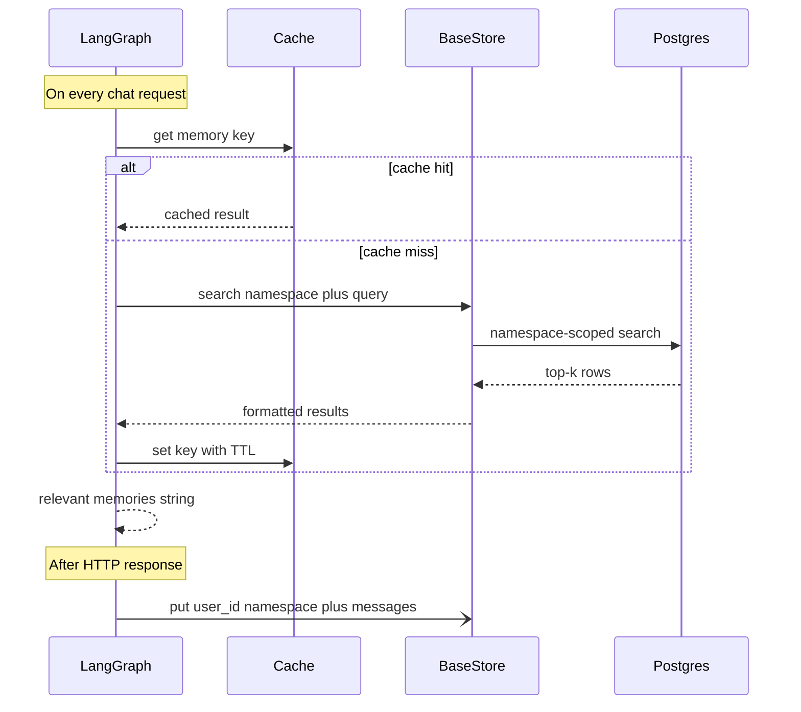

# Memory

Long term memory is live for per-user recall with cache front.
Extraction is heuristic; LLM extraction arrives with the model registry.
This guide describes the shipped behavior plus the target design.

## Status

Short term state lives in the graph checkpointer.
`GraphState` in `src/agent/state.py:1` uses `MessagesState` with `messages` plus a small `docs` list.
Graphs use `make_the_agent(checkpointer, *, store, cache, cache_ttl_seconds, llm)` with `AsyncPostgresSaver` plus a LangGraph `BaseStore` per `docs/structure.md:140`.
Nodes read recall through `get_store` with the per-user namespace `("memories", user_id)`, sync search on the sync path and async search on the async path.
Recall is injected as `docs` on `invoke`, `ainvoke` and `astream` alike when a caller id is present.
The lifespan builds the store with or without Postgres: `InMemoryStore` for fresh clones, pooled `AsyncPostgresStore` with `setup` when `POSTGRES_URI` is set.
Matching is keyword-grade until a store index with real embeddings lands with the model registry.
See `src/agent/graph.py:1` for the wiring point.
See `docs/structure.md:180` for the `src/services/memory.py:1` role.
See `docs/structure.md:173` for the `src/core/cache.py:1` role.
Semantic memory and cache exist with Postgres plus Valkey in compose and in-memory fallbacks in code.
Caller id is transitional `X-User-ID` via `src/api/deps.py:1` until session tokens replace it; production ignores the header so it cannot spoof recall, and overlong ids degrade to no recall instead of colliding.
Today `docker-compose.yml:1` starts pgvector plus Valkey.

## Overview

Each chat turn loads a small set of relevant memories.
Memories are extracted from past conversations with a heuristic.
Memories are stored as plain text rows under the caller namespace.
Retrieval is per user on each request through the bound store.
The agent receives them as plain context text.

## Cache layer

Memory search results are cached for a short time.
The cache avoids repeated vector queries for similar questions.
With Valkey the cache is shared across app instances; sets warm both Valkey and the local map so a Valkey flap does not cause a miss storm.
Without Valkey the code falls back to an in-memory TTL cache with a lock.
The fallback suits a single instance for local work; multi-worker runs need Valkey.
Cache keys look like `memory:{user_id}:{query_hash}`.
TTL comes from `CACHE_TTL_SECONDS` with a default of 60 seconds.
Only successful and non-empty results are cached.
Errors are never cached.
Writes inside the TTL window may stay invisible until expiry; that staleness is accepted per ADR-005.
The local map holds at most 1000 entries with oldest-first eviction.

## Memory updates

Memory writes run after the reply without slowing the async chat path.
On the async path writes run as tracked background tasks drained on shutdown.
On the sync path with no running loop writes run inline so sync turns stay durable.
Failures in background writes are logged and ignored.
The chat response stays correct even when memory fails.

## Configuration

| Variable | Default | Description |
| --- | --- | --- |
| CACHE_TTL_SECONDS | 60 | Memory search cache TTL |
| VALKEY_HOST | empty | Set to enable shared cache |

Values above are planned.
See `.env.example:1` for the current env template.
`POSTGRES_URI` in `.env.example:5` will back both checkpoints and vectors.

## Startup pre-warming

The service will open its vector connection at startup.
It will check the collection schema before serving traffic.
This will avoid paying cold init cost on the first request.
The call will live in the app lifespan when FastAPI exists.
See `docs/structure.md:181` for the database lifespan role.
Checkpointer tables `checkpoints`, `checkpoint_blobs`, and `checkpoint_writes` belong to LangGraph per `docs/structure.md:192`.
Tools live in `src/agent/tools/booking.py:1` as `get_availability`, `book_appointment`, `get_order_status`.

## Per-user isolation

Each user namespace will be isolated by `user_id`.
Search will only return vectors for the requesting user.
Users will never see memories from other users.
Session scope will still come from `thread_id` in the checkpointer.

## What exists today

`docker-compose.yml:1` starts pgvector on port 5432 plus Valkey on port 6379.
`pyproject.toml:1` carries `redis` for the shared cache plus `langgraph-store-postgres` for durable rows.
Rows live in `store` plus `store_vectors` plus `store_migrations`, excluded from Alembic and owned by the store.
Matching is keyword-grade with per-user namespaces until a store index with real embeddings lands.
Writes run as Starlette background tasks after the response, never as untracked loop tasks.
`langgraph.json:1` only maps the graph and env file.

## Next steps

Replace transitional `X-User-ID` with the session token claim.
Replace heuristic extraction with LLM extraction once the model registry lands.
Add a store index with real embeddings, then tune `CACHE_TTL_SECONDS` plus top-k once traces show hit rates.
