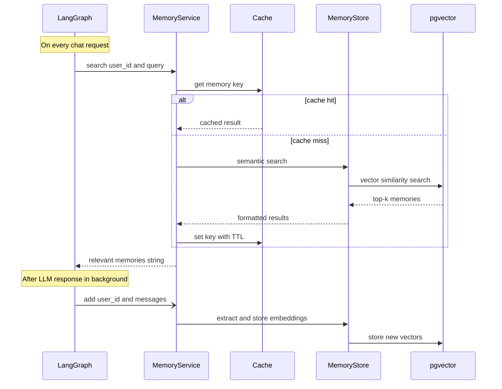

# Memory

Long term memory is live in S2b.
Per-user recall runs on every chat turn with a shared cache front.
Writes run in background after the reply and never slow chat.

## Status

Short term state lives in the graph checkpointer.
`GraphState` in `ws/src/agent/state.py:1` uses `MessagesState` with `messages`.
Graphs use `make_the_agent(checkpointer)` with `AsyncPostgresSaver` per `ws/docs/structure.md:132`.
Semantic recall lives in `ws/src/services/memory.py:1` as `MemoryService` with `recall` plus `remember`.
The cache front lives in `ws/src/core/cache.py:1` as `InMemoryCache` plus `ValkeyCache`.
Chat routes in `ws/src/api/v1/chat.py:1` inject recall as plain context and schedule writes on `BackgroundTasks`.
`ws/docker-compose.yml:1` starts pgvector postgres plus Valkey.

## Overview

Each chat turn will load a small set of relevant memories.
Memories will be extracted from past conversations.
Memories will be stored as vector embeddings.
Retrieval will be semantic per user on each request.
The agent will receive them as plain context text.

## Cache layer

Memory search results are cached for a short time.
The cache avoids repeated vector queries for similar questions.
With `VALKEY_HOST` set the cache is shared across app instances through `ValkeyCache`.
Without `VALKEY_HOST` the code falls back to `InMemoryCache`.
The fallback suits a single instance for local work.
Cache keys look like `memory:{user_id}:{query_hash}`.
TTL comes from `CACHE_TTL_SECONDS` with a default of 60 seconds.
Only successful and non-empty results are cached.
Errors are never cached.

## Memory updates

Memory writes run in the background after the response.
The response returns immediately without waiting for storage.
Memory work does not slow down the chat path.
Failures in background writes are logged and ignored.
The chat response stays correct even when memory fails.

## Configuration

| Variable | Default | Description |
| --- | --- | --- |
| LONG_TERM_MEMORY_COLLECTION_NAME | longterm_memory | Vector collection name |
| LONG_TERM_MEMORY_MODEL | empty | LLM used to extract memories |
| LONG_TERM_MEMORY_EMBEDDER_MODEL | empty | Embedding model for search |
| LONG_TERM_MEMORY_TOP_K | 3 | Memories injected per turn |
| CACHE_TTL_SECONDS | 60 | Memory search cache TTL |
| VALKEY_HOST | empty | Set to enable shared cache |
| VALKEY_PORT | 6379 | Shared cache port |

Values above are live in `ws/src/core/config.py:1`.
See `ws/.env.example:1` for the current env template.
`POSTGRES_URI` in `ws/.env.example:5` will back both checkpoints and vectors.

## Startup pre-warming

The service will open its vector connection at startup.
It will check the collection schema before serving traffic.
This will avoid paying cold init cost on the first request.
The call will live in the app lifespan when FastAPI exists.
See `ws/docs/structure.md:173` for the database lifespan role.
Checkpointer tables `checkpoints`, `checkpoint_blobs`, and `checkpoint_writes` belong to LangGraph per `ws/docs/structure.md:184`.
Tools live in `ws/src/agent/tools/booking.py:1` as `get_availability`, `book_appointment`, `get_order_status`.

## Per-user isolation

Each user namespace is isolated by `user_id`.
Search only returns vectors for the requesting user.
Users never see memories from other users.
Requests without an identity (`anonymous`, no `user_id` and no `X-User-ID`) bypass memory entirely.
That bypass keeps one shared anonymous id from leaking memories across users.
Session scope still comes from `thread_id` in the checkpointer.

## Grounding rule

Retrieved passages always win over recalled memories.
The RAG generator in `ws/src/agent/rag.py:1` answers only from `docs` and cites them.
Memory from `ws/src/services/memory.py:1` arrives as extra background only and never overrides grounding.
When passages do not support the answer the generator replies "I don't know" instead of hallucinating.

## What exists today

`ws/docker-compose.yml:1` starts pgvector postgres on port 5432 plus Valkey on port 6379.
The postgres image carries the `vector` extension and the lifespan runs `CREATE EXTENSION IF NOT EXISTS vector`.
Memory rows live in the `memory_embeddings` table owned by the memory layer.
Alembic never touches that table per `ws/alembic/env.py:1`.
`ws/pyproject.toml:1` includes `redis` for the shared cache client.
Embeddings are a deterministic offline placeholder (`hash_embedding`) until a real embedder model lands.
The requesting user comes from the `user_id` payload field or the `X-User-ID` header.
Auth in S4 will supply the real user id and memory keeps the same per-user contract.

## Next steps

Point the embedder at `LONG_TERM_MEMORY_EMBEDDER_MODEL` once a provider is chosen.
Feed auth user ids into recall once S4 lands.
Tune `LONG_TERM_MEMORY_TOP_K` once grounded answers are measured.
