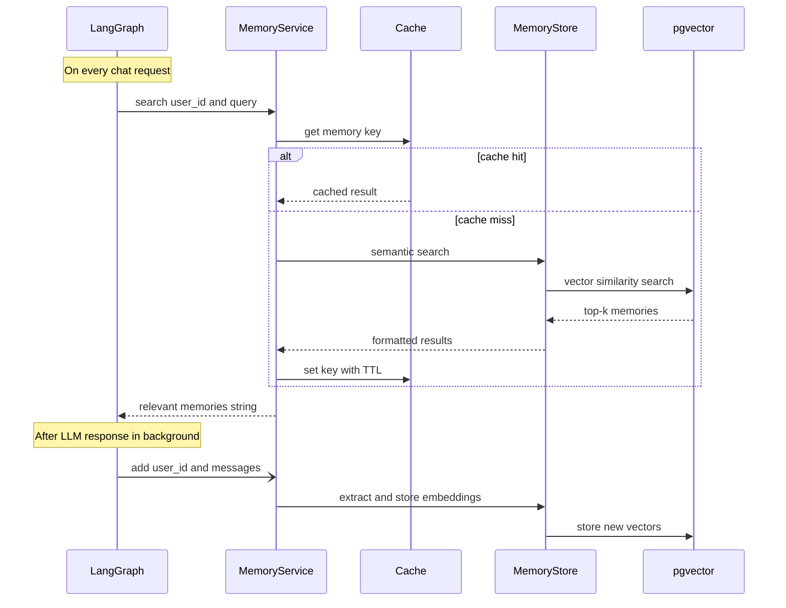

# Memory

Long term memory is live for per-user recall with cache front.
Extraction is heuristic; LLM extraction arrives with later slices.
This guide describes the shipped S2b behavior plus the target design.

## Status

Short term state lives in the graph checkpointer.
`GraphState` in `src/agent/state.py:1` uses `MessagesState` with `messages` plus a small `docs` list.
Graphs use `make_the_agent(checkpointer, recall_hook, store_hook)` with `AsyncPostgresSaver` per `docs/structure.md:140`.
Recall is injected as `docs` on `invoke`, `ainvoke` and `astream` alike when a caller id is present.
The lifespan wires hooks with or without Postgres; without Postgres recall runs on the in-memory fallback so fresh clones keep S2b behavior.
See `src/agent/graph.py:1` for the wiring point.
See `docs/structure.md:180` for the `src/services/memory.py:1` role.
See `docs/structure.md:173` for the `src/core/cache.py:1` role.
Semantic memory and cache exist with pgvector plus Valkey in compose and in-memory fallbacks in code.
Caller id is transitional `X-User-ID` via `src/api/deps.py:1` until S4 session tokens replace it; production ignores the header so it cannot spoof recall.
Today `docker-compose.yml:1` starts pgvector plus Valkey.

## Overview

Each chat turn will load a small set of relevant memories.
Memories will be extracted from past conversations.
Memories will be stored as vector embeddings.
Retrieval will be semantic per user on each request.
The agent will receive them as plain context text.

## Cache layer

Memory search results are cached for a short time.
The cache avoids repeated vector queries for similar questions.
With Valkey the cache is shared across app instances; sets warm both Valkey and the local map so a Valkey flap does not cause a miss storm.
Without Valkey the code falls back to an in-memory TTL cache with a lock.
The fallback suits a single instance for local work; multi-worker runs need Valkey.
Cache keys look like `memory:{user_id}:{query_hash}`.
TTL comes from `CACHE_TTL_SECONDS` with a default of 60 seconds.
Only successful and non-empty results are cached.
Errors are never cached.

## Memory updates

Memory writes run after the reply without slowing the async chat path.
On the async path writes run as tracked background tasks drained on shutdown.
On the sync path with no running loop writes run inline so sync turns stay durable.
Failures in background writes are logged and ignored.
The chat response stays correct even when memory fails.

## Configuration

| Variable | Default | Description |
| --- | --- | --- |
| LONG_TERM_MEMORY_COLLECTION_NAME | longterm_memory | Logical collection name, read at startup |
| LONG_TERM_MEMORY_MODEL | empty | Reserved: LLM used to extract memories |
| LONG_TERM_MEMORY_EMBEDDER_MODEL | empty | Reserved: embedding model for search |
| MEMORY_DISTANCE_MAX | 2.0 | Max vector distance kept; 2.0 keeps top-K unfiltered |
| CACHE_TTL_SECONDS | 60 | Memory search cache TTL |
| VALKEY_HOST | empty | Set to enable shared cache |

Values above are planned.
See `.env.example:1` for the current env template.
`POSTGRES_URI` in `.env.example:5` will back both checkpoints and vectors.

## Startup pre-warming

The service will open its vector connection at startup.
It will check the collection schema before serving traffic.
This will avoid paying cold init cost on the first request.
The call will live in the app lifespan when FastAPI exists.
See `docs/structure.md:181` for the database lifespan role.
Checkpointer tables `checkpoints`, `checkpoint_blobs`, and `checkpoint_writes` belong to LangGraph per `docs/structure.md:192`.
Tools live in `src/agent/tools/booking.py:1` as `get_availability`, `book_appointment`, `get_order_status`.

## Per-user isolation

Each user namespace will be isolated by `user_id`.
Search will only return vectors for the requesting user.
Users will never see memories from other users.
Session scope will still come from `thread_id` in the checkpointer.

## What exists today

`docker-compose.yml:1` starts pgvector on port 5432 plus Valkey on port 6379.
`pyproject.toml:1` carries `redis` for the shared cache front.
Vectors live in `memory_vectors`, excluded from Alembic and owned by the memory layer.
Embeddings are deterministic 64-dim hash vectors until `LONG_TERM_MEMORY_EMBEDDER_MODEL` names a real model, which will need a column migration.
Vector search filters by `MEMORY_DISTANCE_MAX` and the keyword fallback escapes LIKE wildcards.
Postgres opens one short-lived connection per call with a connect timeout; pooling arrives with load in S8.
Degraded turns log a warning with request context and stay correct; counters and traces arrive with S6.
`langgraph.json:1` only maps the graph and env file.

## Next steps

Replace transitional `X-User-ID` with the S4 session token claim.
Replace heuristic extraction with LLM extraction once the model registry lands.
Tune `CACHE_TTL_SECONDS` plus top-k plus `MEMORY_DISTANCE_MAX` once S6 traces show hit rates.
