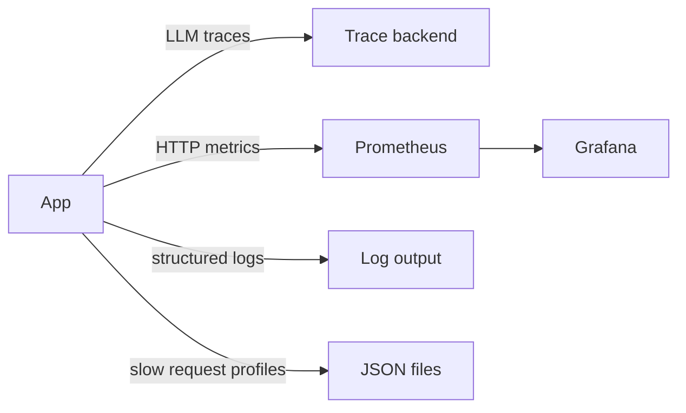

# Observability

Tracing plus metrics plus structured logs are live.
LangSmith covers local runs and Langfuse covers long-term traces when enabled.
This guide describes the live setup for this starter.

## Status

LangSmith keys are present for local runs.
See `.env.example:1` for the key placeholders.
See `langgraph.json:1` for the env pointer used by the CLI.
Structured logs are live via `src/core/middleware.py:1`.
Prometheus metrics are live at `GET /metrics` via `src/api/metrics.py:1`.
Grafana dashboards are stubbed in `grafana/dashboards/latency-errors.json:1`.
See `docs/structure.md:195` for the observability contract.



## Tracing

Every LLM call is traced.
Traces include input messages and output text.
Traces include token usage and latency.
Traces include model name and call parameters.
LangSmith covers local runs through the CLI.
Langfuse is the long-term trace backend when `LANGFUSE_TRACING_ENABLED=true` with keys set.
Traces feed the eval framework in `evals/eval_runner.py:1`.
That file is planned and does not exist yet.
Disable tracing for offline work with env flags.

Live setup:

```bash
cp .env.example .env
uv sync
uv run langgraph dev
```

Set `LANGFUSE_TRACING_ENABLED=false` to run without remote traces.
Set it to `true` once keys are configured.
Set `LANGSMITH_TRACING=true` for local LangSmith traces.

## Structured logging

All logs use structured events.
Development prints readable console output.
Production prints JSON to stdout.
Every line carries request and session context when available.
Context fields are added by middleware plus auth dependencies.
See `docs/structure.md:174` for the middleware role.

Rules to follow:

```python
# Good
logger.info("chat_request_received", session_id=session.id, message_count=5)
```

Use event names in lowercase with underscores.
Pass variables as keyword arguments.
Never interpolate values into the event string.
Use `logger.exception` inside `except` blocks to keep the traceback.

Planned levels by environment:

| Environment | Level |
| --- | --- |
| development | DEBUG |
| staging | INFO |
| production | WARNING |

## Prometheus metrics

Metrics are exposed at `GET /metrics` without auth.
Prometheus scrapes that endpoint on a fixed interval.
Grafana renders the preconfigured dashboards.

Live metrics:

| Metric | Type | Description |
| --- | --- | --- |
| http_requests_total | Counter | Request count by method and status |
| http_request_duration_seconds | Histogram | Request latency by endpoint |
| llm_inference_duration_seconds | Histogram | LLM latency by model |
| db_connections | Gauge | Active database connections |

Code lives in `src/core/middleware.py:1` for collection and `src/api/metrics.py:1` for the scrape target.
Dashboards live in `grafana/dashboards/latency-errors.json:1`.
Scrape config lives in `prometheus/prometheus.yml:1`.

## Request profiling

Slow request profiling runs in debug mode only.
It profiles every request when `DEBUG=true`.
It saves a JSON report when latency passes the threshold.
Each file will be named with the request identifier.
The identifier will match the `X-Request-ID` response header.
Use that header to join logs and traces for one request.
Set the threshold to zero to profile every request.

## Request identifier

Every request will get a unique `X-Request-ID`.
The value will be returned in the response headers.
The value will be bound to every log line for that request.
The value will name the profile file when profiling is on.
This makes one slow request easy to follow end to end.

## What exists today

`Makefile:8` installs deps with `uv sync`.
`Makefile:11` starts the dev server.
`Makefile:14` runs tests with `uv run pytest`.
`GET /metrics` exposes the four signals without auth.
Request ID middleware echoes `X-Request-ID` on every response.
Dashboard stub covers p50 plus p95 plus 5xx rate.

## Next steps

Add per-stage env files for the local stack.
Add stack shortcuts in `Makefile:8` when the full topology lands.
Document new env flags in `.env.example:1`.
