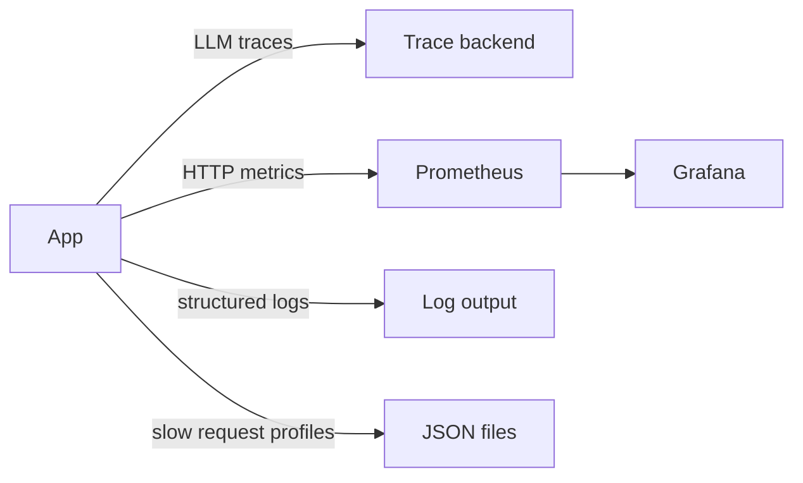

# Observability

Every model call is traced, logs are structured JSON with request context, and metrics render for Prometheus and Grafana.
Request logging and request IDs shipped in S1 and S6 extends that middleware in place.

## Status

LangSmith keys are already present for local runs.
See `ws/.env.example:1` for the key placeholders.
See `ws/langgraph.json:1` for the env pointer used by the CLI.
Structured logs flow through `src/core/middleware.py:1`.
Request IDs flow through `X-Request-ID`.
Metrics are live at `GET /metrics` via `src/core/metrics.py:1`.
Dashboards live in `ws/grafana/dashboards/:1`.
Scrape config lives in `ws/prometheus/prometheus.yml:1`.
See `ws/docs/structure.md:189` for the observability contract.



## Tracing

Every LLM call is traced in `src/core/tracing.py:1`.
Each record carries input messages, output text, token usage, latency, and identity.
Identity covers request id, thread id, and user id when the caller passes them.
The service fills request and thread ids from the log context when callers pass nothing.
Records convert to eval input with `to_eval_record` and feed the runner in `ws/evals/eval_runner.py:1`.
That file is planned and does not exist yet, but the input shape is fixed here first.
LangSmith covers local runs through the CLI and Langfuse stays stubbed.
Disable tracing for offline work with the env flag, no code change needed.

```bash
cp .env.example .env
uv sync
uv run langgraph dev
```

Set `LANGFUSE_TRACING_ENABLED=false` to run without traces.
Set `TRACE_LOG_PATH=traces.jsonl` to persist one JSON line per trace besides the in-memory buffer.
Leave it empty to keep traces in memory only.

## Structured logging

All logs use structured events.
Production prints JSON to stdout through `JsonFormatter`.
Every line carries request and session context when available.
Context fields are bound by `src/core/middleware.py:1` through context vars, so any logger on the request task gets them.
Access logs are one JSON line per request (`http_request_completed`/`http_request_failed`) with `request_id` and `thread_id` to stdout.
See `ws/docs/structure.md:168` for the middleware role.

Rules to follow:

```python
# Good
logger.info("chat_request_received", extra={"session_id": session.id, "message_count": 5})
```

Use event names in lowercase with underscores.
Pass variables through `extra` as fields.
Never interpolate values into the event string.
Never pass `request_id` or `thread_id` in `extra`; the middleware binds them and duplicates raise `KeyError`.
Use `logger.exception` inside `except` blocks to keep the traceback.

Planned levels by environment:

| Environment | Level |
| --- | --- |
| development | DEBUG |
| staging | INFO |
| production | WARNING |

## Prometheus metrics

Metrics are live at `GET /metrics` in Prometheus text format.
Prometheus scrapes that endpoint on a fixed interval with `ws/prometheus/prometheus.yml:1`.
Grafana renders `ws/grafana/dashboards/latency-errors.json:1` for latency and errors.

Live metrics:

| Metric | Type | Description |
| --- | --- | --- |
| http_requests_total | Counter | Request count by method, path, and status |
| http_request_duration_seconds | Histogram | Request latency by method and path |
| llm_inference_duration_seconds | Histogram | LLM latency by model |
| db_connections | Gauge | Active database connections, 1 when the checkpointer is attached |

Code lives in `src/core/middleware.py:1` for request IDs and access logs.
Counting and rendering live in `src/core/metrics.py:1` with no extra dependencies.
LLM latency is observed per model attempt in `src/services/llm/service.py:1`.

## Request profiling

Slow request profiling runs in debug mode only.
It writes one JSON report when latency reaches the threshold.
Each file is named with the request identifier.
The identifier matches the `X-Request-ID` response header.
Use that header to join logs and traces for one request.
Set the threshold to zero to profile every request in debug mode.

```bash
DEBUG=true
SLOW_REQUEST_THRESHOLD_MS=1000.0
PROFILE_DIR=profiles
```

Reports land in `PROFILE_DIR` as `<request_id>.json` with method, path, duration, and thread id.

## Request identifier

Every request gets a unique `X-Request-ID`.
The value is returned in the response headers.
Incoming values are reused when present.
The value is bound to every log line for that request.
`thread_id` from the chat body (or generated) is bound alongside `request_id`.
The value names the profile file when profiling is on.
This makes one slow request easy to follow end to end.

## What exists today

`ws/Makefile:8` installs deps with `uv sync`.
`ws/Makefile:11` starts the dev server.
`ws/Makefile:14` runs tests with `uv run pytest`.
Log middleware exists in `src/core/middleware.py:1` with context binding, metrics, and profiling.
Request IDs exist through `X-Request-ID`.
Metrics are live at `GET /metrics`.
Dashboards exist in `ws/grafana/dashboards/:1`.
Scrape config exists in `ws/prometheus/prometheus.yml:1`.

## Next steps

Point Prometheus at the deployed host in `ws/prometheus/prometheus.yml:1`.
Add alert rules once latency baselines are known.
Document env flags in `ws/.env.example:1`.
