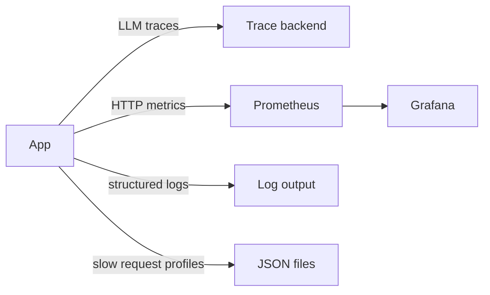

# Observability

Tracing and full metrics are planned.
Request logging and request IDs exist in S1.
This guide describes the target setup for this starter.

## Status

LangSmith keys are already present for local runs.
See `ws/.env.example:1` for the key placeholders.
See `ws/langgraph.json:1` for the env pointer used by the CLI.
Structured logs exist through `src/core/middleware.py:1`.
Request IDs exist through `X-Request-ID`.
Metrics remain a stub at `GET /metrics`.
Grafana dashboards are planned.
See `ws/docs/structure.md:189` for the observability contract.



## Tracing

Every LLM call will be traced.
Traces will include input messages and output text.
Traces will include token usage and latency.
Traces will include model name and call parameters.
LangSmith will cover local runs through the CLI.
Langfuse is planned as the long term trace backend.
Traces will feed the eval framework in `ws/evals/eval_runner.py:1`.
That file is planned and does not exist yet.
Disable tracing for offline work with env flags.

Planned setup:

```bash
cp .env.example .env
uv sync
uv run langgraph dev
```

Set `LANGFUSE_TRACING_ENABLED=false` to run without remote traces.
Set it to `true` once keys are configured.

## Structured logging

All logs use structured events.
Development will print readable console output.
Production will print JSON to stdout.
Every line will carry request and session context when available.
Context fields are added by `src/core/middleware.py:1`.
Access logs are one JSON line per request (`http_request_completed`/`http_request_failed`) with `request_id` and `thread_id` to stdout.
See `ws/docs/structure.md:168` for the middleware role.

Rules to follow:

```python
# Good
logger.info("chat_request_received", session_id=session.id, message_count=5)
```

Use event names in lowercase with underscores.
Pass variables as keyword arguments.
Never interpolate values into the event string.
Use `logger.exception` inside `except` blocks to keep the traceback.

Planned levels by environment:

| Environment | Level |
| --- | --- |
| development | DEBUG |
| staging | INFO |
| production | WARNING |

## Prometheus metrics

Metrics expose a stub at `GET /metrics`.
Prometheus will scrape that endpoint on a fixed interval.
Grafana will render the preconfigured dashboards.

Planned metrics:

| Metric | Type | Description |
| --- | --- | --- |
| http_requests_total | Counter | Request count by method and status |
| http_request_duration_seconds | Histogram | Request latency by endpoint |
| llm_inference_duration_seconds | Histogram | LLM latency by model |
| db_connections | Gauge | Active database connections |

Code lives in `ws/src/core/middleware.py:1` for request IDs and access logs.
Dashboards will live in `ws/grafana/:1` when added.
Scrape config will live in `ws/prometheus/:1` when added.
The metrics backend is still a stub and both paths are planned.

## Request profiling

Slow request profiling is planned for debug mode only.
It will profile every request when `DEBUG=true`.
It will save a JSON report when latency passes the threshold.
Each file will be named with the request identifier.
The identifier will match the `X-Request-ID` response header.
Use that header to join logs and traces for one request.
Set the threshold to zero to profile every request.

## Request identifier

Every request gets a unique `X-Request-ID`.
The value is returned in the response headers.
Incoming values are reused when present.
The value is bound to every log line for that request.
`thread_id` from the chat body (or generated) is bound alongside `request_id`.
The value will name the profile file when profiling is on.
This makes one slow request easy to follow end to end.

## What exists today

`ws/Makefile:8` installs deps with `uv sync`.
`ws/Makefile:11` starts the dev server.
`ws/Makefile:14` runs tests with `uv run pytest`.
Log middleware exists in `src/core/middleware.py:1`.
Request IDs exist through `X-Request-ID`.
Metrics stub exists at `GET /metrics`.
No dashboard files exist yet.

## Next steps

Add `prometheus/` scrape config for local stack.
Add `grafana/` dashboards for latency and errors.
Document env flags in `ws/.env.example:1`.
