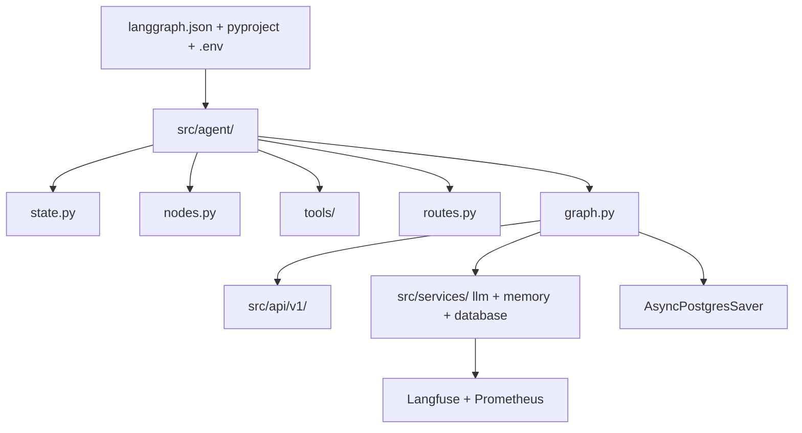

# Structure

This file is the source of truth for the LangGraph project layout.
It combines the official deploy contract with the production layout of the wassim249 FastAPI template.
Start with `src/agent/` flat files.
Grow into `src/api/`, `src/core/`, and `src/services/` only when shipping to users.



## Complete structure

```text
langgraph-base/
├── src/
│   ├── agent/
│   │   ├── __init__.py
│   │   ├── state.py         # GraphState, single source of truth
│   │   ├── graph.py         # StateGraph wiring: chat -> tool_call -> chat
│   │   ├── nodes.py         # chat node, routes with Command to tool_call or END
│   │   ├── tools/           # one @tool module per capability
│   │   │   ├── __init__.py
│   │   │   └── booking.py
│   │   ├── routes.py        # conditional edge functions, no side effects
│   │   ├── prompts/         # system prompt templates, loaded once at startup
│   │   └── configuration.py # Context schema: model name, limits, store name
│   ├── api/
│   │   └── v1/              # route handlers: chat, stream, auth, health
│   │       ├── __init__.py
│   │       ├── chat.py
│   │       └── auth.py
│   ├── core/
│   │   ├── __init__.py
│   │   ├── config.py        # settings loaded from env
│   │   ├── cache.py         # Valkey/Redis with in-memory fallback
│   │   ├── middleware.py    # metrics, logging context, profiling
│   │   └── limiter.py       # rate limiting
│   ├── services/
│   │   ├── __init__.py
│   │   ├── llm/             # registry, retries, circular fallback, timeout budget
│   │   ├── memory.py        # long-term semantic memory plus cache
│   │   └── database.py      # user/session CRUD plus checkpointer lifespan
│   ├── models/              # ORM models
│   └── schemas/             # Pydantic request/response schemas
├── alembic/                 # DB migrations, never touches checkpointer tables
├── evals/
│   └── eval_runner.py       # trajectory scoring, runs on demand
├── tests/
│   ├── unit_tests/          # no model calls: nodes, routes, tools
│   └── integration_tests/   # real models, run on purpose
├── notebooks/
│   └── 01-graph-intro.ipynb # experiments only, never imported by src
├── docs/                    # guides plus structure.md spec, optional
├── grafana/                 # dashboards, optional
├── prometheus/              # metrics config, optional
├── static/
│   └── studio_ui.png        # LangGraph Studio asset, optional
├── docker-compose.yml       # postgres plus pgvector for checkpoints and memory
├── langgraph.json           # graphs, dependencies, env pointer
├── pyproject.toml           # deps and src layout, use uv
├── uv.lock
├── .env.example
├── .env
├── Makefile                 # uv shortcuts: install, dev, test, lint, format
└── README.md                # quickstart only, links here
```

`uv.lock` is generated by `uv sync`.
Do not commit `.env`.
Use `.env.example` as the template.

## uv commands

Run `uv sync` to install dependencies.
Run `uv run langgraph dev` to start the local server.
Run `uv run pytest` to run tests.

## Why this layout

`langgraph.json` is the deploy contract.
`src/agent/` holds the conversation loop and nothing else.
`src/api/` stays thin and never contains graph logic.
`src/services/` owns cross-cutting concerns: LLM fallback, memory, database.
`checkpointer` is injected by factory, never hardcoded in graph module.

## File roles

### `langgraph.json`

This file maps graph name to module variable for CLI and Cloud.
It points `env` to `.env` for local dev.
Production sets env vars in the deployment environment instead.
Example:

```json
{
  "dependencies": ["."],
  "graphs": {
    "agent": "./src/agent/graph.py:graph"
  },
  "env": ".env"
}
```

Extra specialists join as subgraph nodes of the main graph sharing `GraphState`.
They inherit the parent checkpointer, so no extra persistence setup is needed.

### `src/agent/state.py`

This file defines `GraphState`.
Keep state minimal and typed.
Use `MessagesState` as base when the graph is conversational.
Large data stays in tools or the store, never in checkpoints.

### `src/agent/graph.py`

This file builds the two-node loop `chat -> tool_call -> chat`.
The `chat` node returns a `Command` routing to `tool_call` or `END`.
`AsyncPostgresSaver` persists full state per `thread_id` for resume and multi-turn memory.
Export a `graph` variable for `langgraph.json`.
Use a `make_the_agent(checkpointer)` factory when the server injects persistence.
Do not import FastAPI or DB code here.

### `src/agent/nodes.py`

Each function takes state and returns a partial state update.
Keep LLM calls and tool calls here.
Keep routing decisions out of nodes.
Split into `nodes/*.py` when one file exceeds one workflow.

### `src/agent/tools/`

Each module holds `@tool` functions for one capability.
Keep tools small output, clear docstrings, and idempotent where possible.
Export a `tools` list for `llm.bind_tools(tools)`.
Execute concurrent tool calls in parallel and feed results back to `chat`.

### `src/agent/routes.py`

Each function takes state and returns the next node name.
Keep routing pure and deterministic.
Use `with_structured_output` router model when LLM decides the route.
Wire with `add_conditional_edges`.

### `src/api/v1/`

This layer translates HTTP to `graph.invoke` or `graph.stream`.
It owns JWT auth, session scoping, and request schemas.
It never defines nodes, edges, or prompts.

### `src/core/`

`config.py` loads settings from env.
`cache.py` fronts Valkey/Redis with in-memory fallback.
`middleware.py` adds metrics, logging context, and profiling.
`limiter.py` enforces rate limits.

### `src/services/`

`llm/` holds the model registry with retries, circular fallback, and a total timeout budget.
`memory.py` holds long-term semantic memory plus cache.
`database.py` holds user/session CRUD and provides the checkpointer via lifespan dependency.

### `src/models/` and `src/schemas/`

ORM models live in `models/`.
Pydantic request/response schemas live in `schemas/`.
Never expose ORM models directly on the API.

### `alembic/`

Alembic owns the app schema.
It never touches checkpointer tables (`checkpoints`, `checkpoint_blobs`, `checkpoint_writes`) or memory tables.
Exclude external tables in `env.py`.

### Observability

Trace every LLM call with Langfuse.
Expose Prometheus metrics with Grafana dashboards.
Log structured JSON with request, session, and user context on every line.

### `tests/` and `evals/`

Unit test nodes, routes, and tools with fake models and fixed state.
Integration test `graph.invoke` with real models, run on purpose.
Score trajectories (intent, tools called, approvals), not just final answers.
Turn every production failure into a new eval case.

## Workflow patterns supported

This structure supports prompt chaining, parallelization, routing, orchestrator-worker with `Send`, evaluator-optimizer loop, and ReAct agent with tools.
Add one route function per pattern.
Add one worker node per `Send` target.
Cap evaluator loops with a max iteration guard.

## References

1. Application structure - Docs by LangChain - https://docs.langchain.com/oss/python/langgraph/application-structure
2. langchain-ai/new-langgraph-project - https://github.com/langchain-ai/new-langgraph-project
3. langchain-ai/langgraph-example-pyproject - https://github.com/langchain-ai/langgraph-example-pyproject
4. wassim249/fastapi-langgraph-agent-production-ready-template - https://github.com/wassim249/fastapi-langgraph-agent-production-ready-template
5. RealPython LangGraph Tutorial - https://realpython.com/langgraph-python/
6. Workflows and agents patterns - https://docs.langchain.com/oss/python/langgraph/workflows-agents
